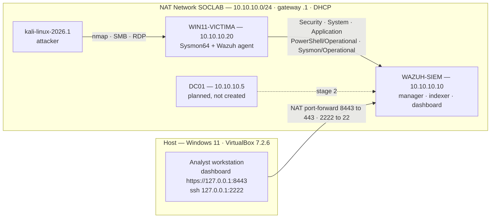

# SOC Home Lab — Detection Engineering & Incident Analysis

A three-VM SOC lab built from scratch (Wazuh 4.14.7, Sysmon, Windows advanced auditing, Kali as the attacker), instrumented well enough to prove where detection **fails**, not only where it works. Every number in this repository was measured on that lab and the command that produced it is written down next to it.

Most home-lab portfolios show a dashboard with alerts on it. This one measures the distance between three different things: what the endpoint **generates**, what the agent **collects**, and what actually **alerts**. In the exercises documented here that gap was large and repeatable: 172 events generated produced 36 alerts, a 65,535-port scan produced none at all, and the single highest-severity alert of the first end-to-end test was a false positive.

---

## Lab architecture

| VM | Role | Specs | Address | State |
|---|---|---|---|---|
| `kali-linux-2026.1` | Attacker | 6 GB RAM / 4 vCPU | DHCP (nic1 NAT for internet, nic2 `SOCLAB`) | Running. Stock image shipped with 37 GB RAM assigned; cut to 6 GB |
| `WAZUH-SIEM` | Wazuh 4.14.7 all-in-one (manager + indexer + dashboard), Ubuntu Server 24.04.4 LTS | 8 GB RAM / 4 vCPU | 10.10.10.10 (static) | Running. ISO SHA256 verified against the official `SHA256SUMS` before install |
| `WIN11-VICTIMA` | Monitored endpoint — Windows 11 Pro 25H2 (build 10.0.26200) | 6 GB RAM / 4 vCPU | 10.10.10.20 (static) | Running. Unattended install from a self-authored `autounattend.xml`; Sysmon64 + Wazuh agent `connected` |
| `DC01` | Domain controller | 4 GB RAM / 2 vCPU | 10.10.10.5 (reserved) | **Not created** — stage 2. DHCP has already handed 10.10.10.5 to Kali, a collision to resolve first |

Host: Ryzen 7 3800X (8c/16t), 48 GB RAM, VirtualBox 7.2.6. The three running VMs use 20 GB of the 48 GB simultaneously. Snapshots named `base-limpia` exist on both the SIEM and the endpoint; restoration was tested and verified (Sysmon64 running, Wazuh service running, static IP intact after rollback).

**Endpoint telemetry baseline**, applied by script and verified afterwards by checking end state rather than by trusting the script's exit: 10 audit subcategories enabled via `auditpol` (Process Creation, Process Termination, Logon, Logoff, Special Logon, Account Lockout, User Account Management, Security Group Management, Audit Policy Change, Security System Extension); command line recorded inside Event ID 4688; PowerShell ScriptBlockLogging (4104) and ModuleLogging (4103); five channels raised from their defaults to 256 MB each (the Security channel defaults to 20 MB); Sysmon64 with the SwiftOnSecurity configuration; inbound ICMP, SMB and RDP opened deliberately so the attacker has a surface.

---

## What this repository contains

| Section | Contents |
|---|---|
| [`docs/`](docs/) | The analysis layer: lab design and decisions, the three-layer coverage model (generate / collect / detect), and the [detection gap analysis](docs/03-detection-gap-analysis.md) |
| [`detections/`](detections/) | Detection logic derived from the measured gaps: the rule inventory, the ATT&CK coverage matrix, and the evidence that justifies each rule |
| [`detections/sigma/`](detections/sigma/) | The rules themselves. 15 `.yml` files holding 25 rule documents, 8 of them correlations. All 25 pass `sigma check` with 0 errors; none has been deployed to the lab manager, so none is validated in the sense this repository defines |
| [`investigations/`](investigations/) | Incident writeups: telemetry visibility exercises and a controlled adversary-emulation chain investigated from the SIEM |
| [`playbooks/`](playbooks/) | Triage procedures for the event types this lab actually produced — failed logons, process creation, service installation |
| [`lab/`](lab/) | How to rebuild all of it: [`lab/README.md`](lab/README.md) plus the baseline and telemetry scripts in `lab/scripts/` |

No credentials, hostnames of third parties, or capture files are committed. The lab account is referred to as `<LAB_USER>` throughout; `10.10.10.x` addresses are a private lab range.

---

## Selected findings

Five results that contradict what the tooling appears to be telling you. Each is reproducible from the scripts and queries in this repository.

**1. The only maximum-severity alert in the first end-to-end test was a false positive generated by PowerShell itself.**
In the 2026-08-08 verification window (00:44:48Z–00:44:56Z) Wazuh raised 82 alerts: 53 at level 3, 7 at level 4, 13 at level 5, 5 at level 8, 3 at level 12 and exactly 1 at level 15. That level 15 was rule 92213 (*Executable file dropped in folder commonly used by malware*, T1105) firing on `__PSScriptPolicyTest_<random>.ps1`, the file that signed system PowerShell writes into `%TEMP%` to test its own execution policy. The same false positive recurred 5 times on 2026-08-11, 12 times on 2026-09-07 and 3 times again on 2026-09-17. Meanwhile the simulated intrusion that mattered (a local account created, added to Administrators and deleted within 8 seconds: 4720 → 4732 → 4726) peaked at levels 8 and 12, underneath it.
*Why it matters:* rule severity encodes how bad the event would be if real, not the probability that it is real. Working a queue top-down by severity spends the shift on PowerShell's own housekeeping, and a level 15 that fires 12 times on benign activity teaches analysts to ignore level 15, which is the failure mode that lets a real incident through.

**2. A full 65,535-port TCP SYN scan produced zero alerts.**
`nmap -sS -p- -T4` against 10.10.10.20 ran 88 seconds (00:47:17Z–00:48:45Z) and found 8 open ports (135, 139, 445, 3389, 5040, 5357, 7680, 49668) with 65,527 filtered. Six Wazuh alerts fell inside those 88 seconds and all six were unrelated background 4688 process-creation events. A later 7-port `-sS -sV` scan left 2 Sysmon Event ID 3 records and 0 Security 5156 records.
*Why it matters:* with the ten audit subcategories enabled on this endpoint, nothing recorded the scan. That is a configuration boundary as well as an architectural one, and the distinction is worth stating precisely. The subcategory that would have recorded it is **Audit Filtering Platform Packet Drop** (5152/5153), which logs a packet the firewall dropped, exactly what the 65,527 filtered ports were. It is off in this lab, deliberately, for volume. **Audit Filtering Platform Connection** (5156/5157) is also off, and would only have recorded the 8 permitted connections, not the 65,527 drops, so it is the wrong subcategory to reach for here. Neither was turned on and re-measured, so this repository has no 5152 count to show. The recommended answer is still a network sensor on the segment rather than more Wazuh rules, but "the host cannot see it" is the weaker claim; "this host was not configured to see it, and here is the control that would" is the one an analyst can act on.

**3. Event ID 4697 is generated on the endpoint, never alerts, and nothing in the dashboard says so.**
A service installation on 2026-08-08 wrote *4697 — A service was installed in the system* to the Security channel; `Get-WinEvent -FilterHashtable @{LogName='Security'; Id=4697}` confirms it. A query of `wazuh-alerts-*` returned 0 documents carrying Event ID 4697. The same real-world fact did alert, through Event ID 7045 from the System channel.
*Why it matters:* coverage has three independent layers, generation, collection and detection, and a hole in the third produces no error, no missing-data indicator and nothing to search for. It is invisible from the console. The only way to find one is to cause the event deliberately and check whether it arrives.

**What this evidence does not establish.** Wazuh indexes what a rule matched, so absence from `wazuh-alerts-*` is equally consistent with the event never being collected. The collection layer here is inferred, not measured: the Security channel is declared in `ossec.conf`, the agent reported `connected`, and the agent's own counter read 2,098 events sent during that verification. None of those separates *this* 4697 from an event that was dropped before the manager, and the same holds for the 110 PowerShell events in the 2026-08-11 exercise. Settling it takes `<logall_json>yes</logall_json>` on the manager and a query against `wazuh-archives-*`, which has not been run. For the 4697 specifically, layer 3 is the likelier of the two for a reason that is measured: other Security-channel events from the same exercise did alert (4688, and the 4720 → 4732 → 4726 sequence at levels 8 to 12), so the channel as a whole was reaching the manager and being analysed. That narrows the question to this Event ID. It does not close it, and the repository says so rather than rounding the inference up to a measurement.

**4. `SubStatus`, not alert count, is what separates blind enumeration from a targeted attack, and lockout policy never sees the first phase.**
18 authentication attempts from 10.10.10.5 on 2026-09-07: 15 × Event ID 4625 with SubStatus `0xC0000064` (account does not exist) against invented usernames between 18:30:10 and 18:30:43, then 3 × 4625 with SubStatus `0xC000006A` (account exists, wrong password) against a real account at 18:31:13–18:31:16. The local lockout threshold is 10 attempts per 10 minutes, so all 15 enumeration attempts were free. `WorkstationName` was empty on every one of them, which is a fingerprint of the tool and not of the operating system behind it: `smbclient`, run from the same Kali VM against the same endpoint on 2026-08-08, populated the field with `KALI`. Treat an empty value as something to check, not as evidence of a non-Windows client.
*Why it matters:* the transition between those two SubStatus values is the exact moment an attacker stops guessing who exists and starts attacking someone who does. A correlation rule that counts failed logons without reading SubStatus cannot see that transition, and account lockout is structurally blind to the enumeration phase.

**5. With Network Level Authentication enabled, a failed RDP login is logon type 3, not type 10.**
Four failed RDP attempts at 18:33:28–18:33:29 produced 4625 events with **logon type 3**. Two authentication-only connections produced 4624 type 3 plus TS-RemoteConnectionManager Event ID 1149, still no type 10. The only logon type 10 in the whole exercise appeared at 18:35:09, when a full graphical session actually established (AuthenticationPackage `Negotiate`, LogonProcessName `User32`, accompanied by LocalSessionManager 41 → 42 → 21 → 22; the 24 in that channel is the disconnection at 18:36:49, not part of establishing the session).
*Why it matters:* NLA moves authentication in front of session creation, so an RDP failure is indistinguishable from an SMB failure by logon type alone. A detection built on "RDP brute force = 4625 type 10" misses every NLA-protected target, which is the default configuration. Reclassifying requires correlating the 4625 with the Terminal Services channel.

Further measured results are in [`investigations/`](investigations/): the `ProcessId` field meaning opposite things in Security 4688 (hex, parent) and Sysmon 1 (decimal, child); a consistent −1.8 s offset between the Wazuh manager timestamp and the endpoint clock, plus a 3–4 s channel-write lag inside Sysmon events 3 and 22; and the field-by-field comparison showing the seven things 4688 lacks that Sysmon 1 supplies.

---

## Detection coverage

What the lab sees, stated as a funnel rather than as a claim.

| Exercise | Generated | Alerted |
|---|---|---|
| 2026-08-08 end-to-end verification | ~2,100 events reported by the agent (2,098 counted at the collection check) | 835 alerts indexed for the endpoint |
| 2026-08-11 visibility exercise | 172 events across 5 channels, recounted over the widened window (a first pass reported 167) | 36 alerts |

**Covered.** Process creation: Security 4688 alerted 16 of 16, though through catch-all rule 67027 at level 3, which is coverage plus noise rather than detection. Account manipulation: create / add-to-Administrators / delete all alerted (rules 60109, 60110, 60111, 60154, levels 8–12). Authentication failures: rule 60122 at level 5 accumulating into rule 60204 at level 10. Anonymous SMB session: rule 92652 at level 6, the most informative alert of an entire reconnaissance phase, sitting nine levels below the twelve level 15 false positives in the same exercise. Encoded PowerShell: rule 92057 at level 12, which fired on a Sysmon Event ID 1, not on the 4104 the exercise had predicted.

**Not covered, measured.** Channels ingested with zero detection coverage in the 2026-08-11 exercise: Sysmon 3 network (0 of 1), Sysmon 22 DNS (0 of 1), PowerShell 4103/4104 and related (0 of 110), Security 4648 explicit-credential logon (0 of 1), Security 4798/4799 local group enumeration (0 of 2, literally what SharpHound does), Security 4689 (0 of 12). Sysmon Event ID 1 alerted 1 time in 11, and that one fired on the parent-child *pattern* `powershell → cmd`, not on process creation.

**Not covered, structural.**
- No network visibility. Port scans are invisible to this lab (finding 2). Both Filtering Platform subcategories are deliberately off for volume reasons: Packet Drop (5152/5153), which would have recorded the dropped SYNs, and Connection (5156/5157), which would only have recorded the permitted ones. Neither was enabled and re-measured. The honest answer is that this belongs to a network IDS on the segment.
- No domain. `DC01` does not exist, so nothing here covers Kerberos, GPO, or domain lateral movement.
- No packet capture. The adversary-emulation exercise was investigated entirely from host logs.
- No time synchronisation between endpoint and SIEM; the −1.8 s offset is uncorrected and matters more once a DC joins.
- Security Event ID 1102 (audit log cleared) has **never been generated** in this lab, so its detection path is untested and is listed as untested rather than as covered.
- Rule 92213 has not been tuned on the manager, so level 15 currently carries no information here. A replacement rule is drafted in [`detections/sigma/`](detections/sigma/) and, like every rule there, has not been deployed.

Full gap inventory, each entry with its evidence and a proposed rule: **[`docs/03-detection-gap-analysis.md`](docs/03-detection-gap-analysis.md)**.

One methodological caveat, because it changed a result: an apparent coverage gap in 4624/4672 turned out to be an artefact of a narrow query window: widening the range from 20 to 40 seconds showed 8 × 4624 and 4 × 4672, every one alerting. Each remote invocation produces a *pair* of 4624 events and the boundary was cutting the pairs in half. Only gaps that survived a widened window are reported above.

---

## Reproducing this lab

Everything is rebuildable from [`lab/README.md`](lab/README.md): network and VM creation with `VBoxManage`, the unattended Windows install, the telemetry baseline scripts, the Wazuh agent deployment, and the query method used throughout. The Wazuh indexer listens only on localhost inside the SIEM, so host-side queries go through the dashboard console proxy on 8443 rather than a port-forward to 9200.

Scripts verify their own end state. A telemetry baseline script that appears to run but silently aborted half way is worse than none, because the analyst then believes Sysmon is collecting when it is not. That exact failure happened here and is documented.

---

## Current focus

- **Deploy and validate what is already written.** [`detections/sigma/`](detections/sigma/) holds 15 files and 25 rule documents covering the measured gaps: Security 4697, the discovery *sequence* (three or more of `whoami` / `net user` / `net localgroup` / `nltest` / `systeminfo` under one parent within 60 seconds), password spraying keyed on SubStatus `0xC0000064`, RDP behind NLA, the Sysmon 3 and 22 gaps, and the 92213 tuning for the PowerShell execution-policy test file. They pass `sigma check`, they convert under the OpenSearch backends, and not one of them has run against lab data. Writing a rule is the easy half; the work still outstanding is loading them into the manager, measuring what they fire on and what they miss, and recording both.
- Write the rules that genuinely do not exist yet: Security 4648 (explicit-credential logon) and 4798/4799 (local group enumeration, which is literally what SharpHound does).
- Trigger Security 1102 deliberately and confirm the alert path end to end. The `base-limpia` snapshots exist for exactly this.
- Configure NTP on both VMs and pin dashboard queries to `data.win.system.systemTime` (and to `UtcTime` for Sysmon 3 and 22).
- Stage 2: build `DC01`, after resolving the DHCP collision on 10.10.10.5.
- Decide the network-visibility question honestly: enable Audit Filtering Platform Packet Drop (5152/5153) and accept the volume, or add a network sensor to the segment. Either way, measure the 88-second scan again afterwards rather than assuming the answer.
- CompTIA Security+ SY0-701 in progress. The method is the part worth stating here: every objective gets written out in my own words before I sit a diagnostic, because an explanation I cannot finish is a knowledge gap with an address. It held 5 for 5 against the first diagnostic — every blank left in my notes came back as a wrong answer. Recorded as lesson L-22 in [`docs/04-lessons-learned.md`](docs/04-lessons-learned.md).

---

Licensed under the [MIT License](LICENSE).
