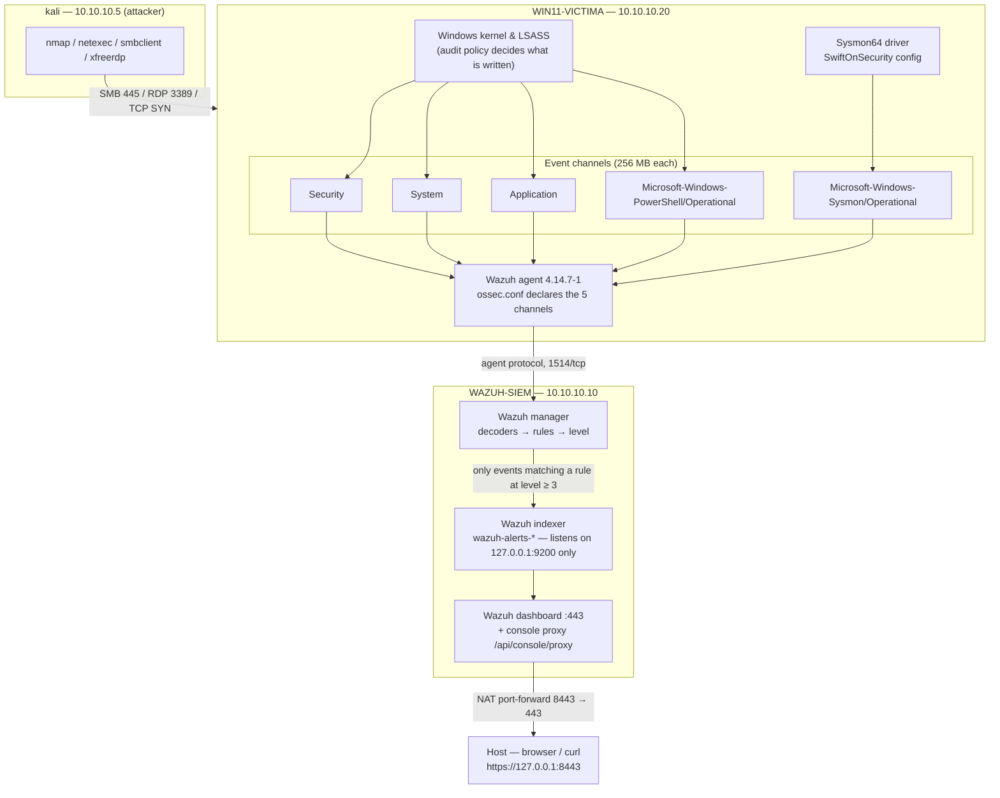

# Lab Architecture

Every number in this document was measured on the lab described here unless the text says
otherwise, and nothing is taken from vendor documentation unless it is labelled as such. Where a
value was obtained by running a command, the command is named. Two figures are inferences rather
than measurements and are marked where they appear: the share of disk consumption attributed to
the lab (§1), and the claim that the five declared channels reach the manager (§4.1, §4.2).

Credentials are never written in this repository. The lab account appears as `<LAB_USER>`
and passwords as `<REDACTED>`. The `10.10.10.0/24` addresses are RFC1918 lab addresses and
are safe to publish.

---

## 1. What this lab is

A self-built home SOC lab used to generate attack telemetry, collect it into a SIEM, and then
investigate it. It runs entirely on one desktop machine. It exists to answer one question
repeatedly: *when something happens on an endpoint, what reaches the analyst, and what does
not?*

The whole of `02-detection-methodology.md` comes out of measurements taken here.

### Host

| Item | Value |
|---|---|
| CPU | Ryzen 7 3800X, 8 cores / 16 threads |
| RAM | 48 GB |
| Host OS | Windows 11 |
| Hypervisor | VirtualBox 7.2.6 (`VBoxManage.exe`) |
| Storage | Single disk, C: 952 GB total |
| Free space 2026-07-29 | 259 GB |
| Free space 2026-09-07 | 46 GB (96% used) |
| RAM in use with all three VMs running | 20 GB of 48 GB |

The disk figures are included deliberately. Free space on the single host disk fell from 259 GB
to 46 GB over about six weeks — three VMs with 256 MB event channels, their snapshots and the
ISOs account for most of that. The 213 GB is a whole-disk delta, not a per-VM measurement: the
same disk holds unrelated material, so it is an upper bound on what the lab consumed. The VDI
files were never sized individually. Capacity planning is part of running a SIEM, and this lab
ran into it early.

---

## 2. Network

A single VirtualBox **NAT Network** named `SOCLAB`:

| Property | Value |
|---|---|
| Subnet | `10.10.10.0/24` |
| Gateway | `10.10.10.1` |
| DHCP | Enabled |
| VM-to-VM traffic | Allowed |
| Internet from VMs | Allowed (via the NAT gateway) |

A NAT Network was chosen over Host-Only because the VMs need internet access (package
installs, Wazuh ruleset updates, ATT&CK references) *and* need to see each other. A Host-Only
network gives the second without the first; NAT (the per-VM kind) gives the first without the
second.

The consequence is that the host is not on `10.10.10.0/24` and cannot reach the VMs directly.
Access from the host goes through NAT port-forward rules:

| Host | Guest | Purpose |
|---|---|---|
| `127.0.0.1:8443` | `10.10.10.10:443` | Wazuh dashboard, `https://127.0.0.1:8443` |
| `127.0.0.1:2222` | `10.10.10.10:22` | SSH to the SIEM |

### Address plan and one known collision

| Address | Assigned to | Notes |
|---|---|---|
| `10.10.10.1` | NAT gateway | — |
| `10.10.10.5` | Reserved for `DC01` (stage 2) | **Currently held by Kali via DHCP.** Documented collision, must be resolved before the domain controller is built. |
| `10.10.10.10` | `WAZUH-SIEM` | Static |
| `10.10.10.20` | `WIN11-VICTIMA` | Static |

Kali received `10.10.10.5` from the `SOCLAB` DHCP pool, which is the address the plan reserves
for the future domain controller. It is recorded here rather than silently fixed because every
attack writeup in this repository names `10.10.10.5` as the attacker source, and that has to
stay readable later.

---

## 3. Virtual machines

### 3.1 `kali-linux-2026.1-virtualbox-amd64` — attacker

| Property | Value |
|---|---|
| RAM / vCPU | 6 GB / 4 |
| Address | DHCP (currently `10.10.10.5`) |
| NIC 1 | NAT (internet) |
| NIC 2 | `SOCLAB` |

The stock VirtualBox image shipped with **37 GB of RAM assigned**, which on a 48 GB host
starves everything else. It was cut to 6 GB. The second NIC was added without touching the
first, so the attacker keeps internet access for tool updates while attacking the lab segment.

Tooling actually used against the lab: `nmap` (`-sn`, `-sS -p-`, `-sS -sV`), `netexec`
(null session, password guessing, `--shares`), `smbclient -L`, and `xfreerdp` run headless
under `xvfb-run -a`.

### 3.2 `WAZUH-SIEM` — SIEM

| Property | Value |
|---|---|
| OS | Ubuntu Server 24.04.4 LTS |
| RAM / vCPU | 8 GB / 4 |
| Address | Static `10.10.10.10` |
| Remote access | OpenSSH (via `127.0.0.1:2222`) |
| SIEM | Wazuh 4.14 all-in-one (installer resolves to 4.14.7), installed 2026-08-05 |

Installed with the vendor's all-in-one script (`wazuh-install.sh -a`), which deploys manager,
indexer and dashboard on the same host. The Ubuntu ISO's SHA256 was verified against the
official `SHA256SUMS` before it was ever booted.

### 3.3 `WIN11-VICTIMA` — monitored endpoint

| Property | Value |
|---|---|
| OS | Windows 11 Pro, build 10.0.26200 (25H2) |
| RAM / vCPU | 6 GB / 4 |
| Address | Static `10.10.10.20` |
| Firmware | EFI + TPM 2.0 |
| Network profile | Private |
| Guest Additions | 7.2.6 |
| Installed | 2026-08-07, unattended, from a self-authored `autounattend.xml` |

Pro edition, not Home: Home cannot join a domain (which would break stage 2) and has no RDP
server (which would make logon type 10 unreachable). The unattended install took the disk from
0 to 17.2 GB.

Inbound ICMP, SMB and RDP were opened **deliberately** in the Windows firewall. The endpoint is
meant to be attackable; a closed host produces no interesting telemetry.

### 3.4 `DC01` — planned, not built

Windows Server domain controller, 4 GB / 2 vCPU, `10.10.10.5`. Stage 2. Section 6 explains why
it is not first.

### 3.5 Snapshots

Snapshots named `base-limpia` ("clean baseline") exist on both `WAZUH-SIEM` and
`WIN11-VICTIMA`, and **restoration was tested rather than assumed**. After restoring the
endpoint: `Sysmon64` service RUNNING, `WazuhSvc` RUNNING, address still `10.10.10.20`. This
matters for destructive exercises — Security Event ID 1102 (audit log cleared) is on the
to-do list precisely because a rollback point exists.

---

## 4. Telemetry pipeline

### 4.1 Data flow



The important edge in that diagram is `MGR --> IDX`. **The manager only writes to the index
what a rule matched.** Everything else is discarded. That single arrow is the origin of the
three-layer coverage model in `02-detection-methodology.md`.

Measured funnel, with each column labelled for what was actually counted rather than for the
stage it is meant to represent:

| Exercise | Into the pipeline | Alerts left in the index |
|---|---|---|
| 2026-08-08 | ~2,100 — the agent's own send counter read 2,098 sent. Agent-side; never confirmed at the manager | 835 for that endpoint |
| 2026-08-11 (B4) | 172 counted on the endpoint with `Get-WinEvent` over the widened window. How many arrived at the manager was not counted. A first pass over a narrower window gave 167 | 36 |

**Nothing in this lab has counted what reached the manager.** The manager indexes only what
matched a rule, so an event that matched nothing leaves nothing to count — unless
`<logall_json>yes</logall_json>` is enabled and `wazuh-archives-*` is queried, which has not been
done here. Collection on this endpoint is therefore *inferred* from two facts (the channel is
named in `ossec.conf`, and the agent reported `connected`), not measured. That inference is
load-bearing for the whole three-layer model, and `02-detection-methodology.md` §2 states plainly
what would turn it into a measurement.

### 4.2 Channels collected

The Wazuh agent's `ossec.conf` declares five channels:

| Channel | What it carries here |
|---|---|
| `Security` | Audited events: logon/logoff, process creation, account and group changes, service installation (4697), audit policy changes |
| `System` | Service control manager, including Event ID 7045 (service installed) |
| `Application` | Application-level errors and installer output |
| `Microsoft-Windows-PowerShell/Operational` | 4103 module logging, 4104 script block logging |
| `Microsoft-Windows-Sysmon/Operational` | Sysmon events 1, 3, 11, 13, 22 and the rest of the SwiftOnSecurity set |

Agent status was confirmed `connected` before any exercise was run. That status, plus the channel
being named in `ossec.conf`, is the entire evidence that these five channels are collected: no
host-to-manager count was ever taken for any of them (section 4.1). A collected channel is not a
detected channel — see section 4.6.

### 4.3 Audit policy

Set with `auditpol`, not with the legacy nine categories. Ten subcategories enabled:

| Subcategory | Key Event IDs | Why it is on |
|---|---|---|
| Process Creation | 4688 | The backbone of endpoint detection. Without it there is no process history at all. |
| Process Termination | 4689 | Bounds a process's lifetime, which is what makes a PID unambiguous in a timeline. |
| Logon | 4624, 4625 | Who got in, who failed, from where, by which mechanism. |
| Logoff | 4634, 4647 | Closes the session, so `LogonId` can be scoped to a window. |
| Special Logon | 4672 | Privileged account logon. Misread constantly — see the caveat below. |
| Account Lockout | 4625 with Status `0xC0000234` | The tail end of a brute-force attempt: the logon attempt made against an account that is *already* locked out. This subcategory does **not** write 4740, despite its name. |
| User Account Management | 4720, 4722, 4726, 4738, **4740** | Account creation, enabling, deletion, modification — and the lockout event itself. 4740 ("a user account was locked out") is written here. |
| Security Group Management | 4732, 4733 here; 4728, 4729 only once a DC exists | Privilege escalation by group membership. On this standalone host only the *local* group events (4732/4733) can occur: 4728/4729 describe security-enabled **global** groups and are written by a domain controller, which this lab does not have. |
| Audit Policy Change | 4719 | An attacker turning off the logging is itself the signal. |
| Security System Extension | 4697 | Service installation — a classic persistence mechanism. |

Two subcategories were deliberately **not** enabled:

- **Filtering Platform Connection (5156/5157)** — very high volume. This was a conscious trade,
  not an oversight.
- **Object Access / file auditing, including File Share** — not needed for the current exercises,
  and it multiplies volume on a 256 MB channel. The cost is specific rather than vague: *Object
  Access → File Share* writes 5145 (detailed share access — which is what an `IPC$` /
  `srvsvc` share enumeration produces) and 5140, so with it off there is no host event tying a
  share enumeration to the session that performed it.

A third was left off for a worse reason — it was not considered when this baseline was written —
and it is the one that matters most to section 7:

- **Filtering Platform Packet Drop (5152/5153)** — this is the subcategory that records a packet
  the host firewall **dropped**, which is exactly the condition behind the 65,527 filtered ports
  in the scan measured in section 7. Filtering Platform *Connection* would not have covered it:
  5156 means *a connection was permitted*, so it would have recorded only the 8 open ports. The
  distinction was missed when the audit policy was set. It is recorded here rather than quietly
  corrected, because it changes what section 7 is allowed to claim. Packet Drop has **not** been
  switched on, so nothing in this repository measures what it would have produced.

Both Filtering Platform subcategories being off is the direct cause of this lab having no
network-level host visibility (section 7).

Caveat recorded from measurement: **4672 means the account is privileged, not that the process
is elevated.** Every `VBoxManage guestcontrol run` produced *two* 4624 events with two
different `LogonId` values — one with `elevatedToken %%1842` (Yes) plus a 4672, and one with
`%%1843` (No) and no 4672. The pattern held on **4 out of 4 invocations**, which is what the
widened-window count of 8 × 4624 and 4 × 4672 is: four invocations, one pair plus one 4672
each. The processes that actually
launched carried the second `LogonId` and their 4688 recorded `TokenElevationType %%1938`
(Limited). That is the UAC linked token visible in the log.

### 4.4 Settings that had to be turned on by hand

#### Command line inside 4688

By default, Event ID 4688 records `NewProcessName` — the path of the binary — and nothing about
its arguments. `C:\Windows\System32\cmd.exe` is the same string whether it ran `dir` or a
download cradle. Enabling `ProcessCreationIncludeCmdLine_Enabled = 1` puts the full command
line into the event.

This was measured against Sysmon Event ID 1 on the same process. Even with the registry value
set, **4688 still lacks seven things Sysmon 1 provides**:

| Field | Security 4688 | Sysmon 1 |
|---|---|---|
| `CommandLine` | Yes (only after the registry change) | Yes |
| `ParentCommandLine` | **No** | Yes |
| Hashes (MD5 / SHA256 / IMPHASH) | **No** | Yes |
| `OriginalFileName` | **No** | Yes (`PowerShell.EXE`) |
| File metadata (FileVersion/Description/Product/Company) | **No** | Yes |
| `CurrentDirectory` | **No** | Yes |
| Stable process identifier | **No** (PID only, and PIDs recycle) | `ProcessGuid` |
| Integrity level | As a SID, `MandatoryLabel S-1-16-8192` | `IntegrityLevel = Medium`, in words |
| `TokenElevationType` | Yes (`%%1938` = Limited) | **No** |

Both carry the session: 4688 `SubjectLogonId` matched Sysmon `LogonId` exactly on the measured
event.

Two consequences follow:

1. **Missing `ParentCommandLine` is the expensive omission.** With 4688 alone the analyst knows
   the parent was `cmd.exe` but not what that `cmd.exe` was doing, and must rebuild the chain by
   joining on PIDs that get recycled.
2. **Missing `OriginalFileName` makes T1036.003 (Rename System Utility) undetectable from the
   Security log.** If `powershell.exe` is copied to `C:\Users\Public\svchost.exe`, both Sysmon's
   `Image` and 4688's `NewProcessName` report the lie; only `OriginalFileName` still reports
   `PowerShell.EXE`. That is the concrete, measured argument for running Sysmon *in addition to*
   native auditing, not instead of it.

One more trap found by comparing the two sources on the same process: **the field called
`ProcessId` means opposite things in different number bases.** Security 4688 reports
`NewProcessId 0x1250` for the *created* process and `ProcessId 0xdb4` for the *parent*, both
hexadecimal. Sysmon 1 reports `ProcessId 4688` for the *created* process and
`ParentProcessId 3508`, both decimal. Correlating on field name alone inverts the process tree
silently and produces a wrong report built from correct data.

#### PowerShell Script Block Logging (4104)

Records the actual script block text after PowerShell has decoded and de-obfuscated it. This is
what defeats `-EncodedCommand`, string concatenation and back-tick padding: whatever tricks were
used to build the command, 4104 logs the code the engine ultimately ran.

Measured caveat from 2026-08-08: `powershell.exe -EncodedCommand` did generate the 4104, but the
alert that actually fired was Wazuh rule 92057 (level 12) on a **Sysmon Event ID 1**, not on the
4104. The exercise had predicted the opposite. Generation and detection are different layers.

#### PowerShell Module Logging (4103)

Records pipeline execution details — which cmdlets ran with which bound parameters. It overlaps
4104 but catches interactive pipeline use that never forms a distinct script block.

Honest note on both: in the B4 exercise the PowerShell channel produced **110 events and 0
alerts**. The telemetry is being generated and collected, and nothing in the default ruleset
looks at it. That is a real, open detection gap, not a configuration error.

#### Channel sizing — 256 MB

`Security`, `System`, `Application`, `PowerShell/Operational` and `Sysmon/Operational` were each
raised to **268,435,456 bytes (256 MB)**. The Security channel defaults to 20 MB.

Windows event channels are circular buffers. At default size, on a host with process creation
auditing and Sysmon both enabled, the oldest events are overwritten quickly — and the overwrite
is silent. An analyst who investigates on Monday an alert from Friday can find that the
supporting context no longer exists. Raising the channel size buys retention on the endpoint,
which is the only copy of everything the SIEM chose not to index (section 4.6).

### 4.5 Sysmon

`Sysmon64` with the SwiftOnSecurity `sysmon-config` XML. That configuration is used because it
is opinionated about noise: it ships with exclusions rather than logging everything, which is
what keeps the channel usable at 256 MB.

Sysmon's unique contribution in this lab, measured rather than claimed:

- `ProcessGuid` — never recycles, and it is what ties a process to its network (Sysmon 3) and
  DNS (Sysmon 22) events. All three carried the same GUID segment in the B4 exercise. PIDs
  cannot do this.
- Hashes on process creation. Three distinct SHA256 values were captured in B4 (`powershell.exe`,
  `cmd.exe`, `whoami.exe`), all legitimate signed system binaries from a benign exercise.
- `OriginalFileName`, as above.

### 4.6 The manager, and what it throws away

The agent ships events; the manager decodes them, runs them through the ruleset, and **writes
to the index only what matched a rule at level ≥ 3**. Everything else is gone as far as the
dashboard is concerned.

Measured consequences:

- In B4, Security 4688 alerted **16 of 16** — but through rule 67027, a catch-all that fires on
  every process creation at level 3. Full coverage and full noise, from the same rule.
- Sysmon Event ID 1 alerted **1 of 11**, and the one that fired (rule 92004, level 4, "Powershell
  process spawned Windows command shell instance") fired on the *pattern* `powershell → cmd`,
  not on process creation. Sysmon delivers signal, but only where a rule is looking.
- Sysmon 3 (network): 0 of 1. Sysmon 22 (DNS): 0 of 1. PowerShell 4103/4104: 0 of 110.
  Security 4648: 0 of 1. Security 4798/4799: 0 of 2. Security 4689: 0 of 12.

### 4.7 Querying the SIEM from the host

The Wazuh indexer listens on port 9200 **only on localhost inside the SIEM VM**. A VirtualBox
NAT port-forward to 9200 therefore fails — `curl` returns error 35 (TLS), because the NAT proxy
answers the TCP handshake and nothing behind it speaks TLS.

The path that works is the dashboard's console proxy, already exposed on 8443, which accepts
basic auth:

```bash
curl -k -u admin:<REDACTED> -H 'osd-xsrf: true' -H 'Content-Type: application/json' \
  -X POST "https://127.0.0.1:8443/api/console/proxy?path=wazuh-alerts-*/_search&method=POST" \
  -d @query.json
```

This is what made every alert count in this repository scripted and repeatable instead of
counted by clicking through the dashboard. Queries are OpenSearch-style JSON:
`bool`/`filter`/`range` plus `terms` aggregations on `rule.id`, `rule.level`, `rule.mitre.id`
and `data.win.system.eventRecordID`.

---

## 5. Automation from the host, and its limits

The endpoint is driven from the host with `VBoxManage guestcontrol copyto` / `copyfrom` / `run`
(Guest Additions 7.2.6), which avoids typing scripts into a VM console. Four things were
learned the hard way and are recorded because they shaped how every exercise is run:

1. **`guestcontrol run` does not hand out an elevated token.** Although `<LAB_USER>` is in the
   local Administrators group, `whoami /groups` inside a launched process showed
   `BUILTIN\Administrators` as *"Group used for deny only"* and `Medium Mandatory Level`.
   Setting `LocalAccountTokenFilterPolicy=1` did **not** change it (tested and reverted): that
   key applies only to network logons, and VirtualBox performs an interactive logon. The working
   path is to open one elevated terminal by injected scancodes and drive it, capturing output
   with `Start-Transcript` to a world-readable file retrieved with `copyfrom`. This is the same
   UAC linked-token mechanism as the 4672/4624 pairing above — the control that blocks an
   attacker's silent elevation also blocks legitimate automation.
2. **Group membership for log access lives in the token, not the SAM.** Adding `<LAB_USER>` to
   `Event Log Readers` made `Get-LocalGroupMember` show it immediately, but `guestcontrol`
   processes kept failing with *"Attempted to perform an unauthorized operation"* until the VM
   was **rebooted**. `guestcontrol closesession --all` did not refresh it. This is
   group-membership caching, not UAC filtering. The Sysmon channel already ships with the ACE
   `(A;;0x1;;;S-1-5-32-573)`, so its SDDL needed no change.
3. **`guestcontrol run -- …` duplicates `argv[0]`, and does so differently per guest OS.** On
   Windows the binary name must be repeated after `--`; on Linux it must not. When it was wrong,
   PowerShell received `powershell.exe` as its first argument, treated it as `-Command`, and
   relaunched itself — which showed up as *two* `powershell.exe` in the captured process tree
   where one was expected. The command's output looked completely correct. Reading the process
   tree is what exposed it.
4. **Never wrap a configuration script in `*>&1 | Tee-Object` under PowerShell 5.1.** It converts
   any native executable's stderr into an `ErrorRecord`, and with `$ErrorActionPreference='Stop'`
   the script aborts. This silently killed `01-telemetria-win11.ps1` at step 6: steps 1–5 applied
   and `Sysmon64.exe -i` never installed the service. `Start-Transcript` is the correct
   substitute. The lesson generalises: **a script that configures logging must be verified by
   checking the end state** (`Get-Service Sysmon64` = Running, events present in the channel),
   never by the fact that it appeared to run. A partially applied telemetry baseline is worse
   than none, because the analyst believes Sysmon is running when it is not.

---

## 6. Design decisions and their trade-offs

### Wazuh, not Security Onion or Splunk

| Option | Why not |
|---|---|
| Security Onion | Asks for 16 GB of RAM for itself. On a 48 GB host already running an endpoint, an attacker box and the host OS, it does not leave room for the rest of the lab. |
| Splunk Free | Licence limits ingest to 500 MB/day. One noisy exercise with process creation auditing plus Sysmon reaches that, and then the lab is measuring the licence instead of the detections. |

Wazuh was chosen for: no volume limit, an install that fits in one script, and ATT&CK technique
IDs attached to rules out of the box (which is what made every `rule.mitre.id` aggregation in
this repository possible).

**The trade-off is real and it is visible throughout these documents.** Wazuh's default ruleset
is uneven: it alerts on 100% of process creations at level 3, on 0% of PowerShell script blocks,
and fires level 15 on a file PowerShell writes for itself. A commercial platform with curated
content would not behave this way. The compensation is that the gaps are *visible* and can be
measured, which turned out to be more instructive than a ruleset that quietly works.

### A standalone endpoint before a domain controller

Active Directory is where most home labs are built first and abandoned shortly after. The
decision here was to get one Windows host producing readable telemetry, and to learn to read
4624 / 4625 / 4688 / Sysmon 1 on it, before adding a DC.

Trade-off, stated plainly: a standalone box cannot produce Kerberos events, and therefore no
4768/4769/4771, no Kerberoasting, no Golden Ticket, no DCSync, and no lateral movement between
domain-joined machines. A large part of real SOC work is invisible in stage 1. That is accepted
as the cost of not skipping the fundamentals.

Adding the DC also raises the stakes on the time problem in section 7: Kerberos rejects clock
skew above five minutes, and this lab currently has no NTP synchronisation at all.

### Windows in English

The OS, not the analyst, is in English. Every Sigma rule, every vendor detection write-up and
every ATT&CK page describes events using their English strings. A Spanish-locale Windows writes
`Se ha creado un proceso` where the rule expects `A new process has been created`, and string
matching then fails on events that were generated and collected correctly — a fourth way to
produce the same silence described in `02-detection-methodology.md`. The trade-off is that the
lab does not reflect the localisation an analyst may face in a Spanish-speaking organisation;
that is a known and accepted gap.

### Kali as attacker only

The attacker VM exists to generate telemetry, not to be the subject of study. Blue-team work
here is Windows, logs and the SIEM.

### Unattended Windows install

Windows 11 was installed from a self-authored `autounattend.xml`, packaged into an ISO with
**IMAPI2** (built into Windows) because `oscdimg` ships only with the ADK. The install is
therefore reproducible: the endpoint can be rebuilt from scratch rather than restored from a
snapshot, which matters if the baseline itself is ever suspect.

The Windows 11 25H2 ISO was obtained with Fido after the Microsoft web download failed.
Microsoft does not publish SHA256 values for consumer ISOs, so the image was validated by
mounting it and confirming `setup.exe`, `boot.wim` and `install.wim`, and its own hash was
recorded locally. This is weaker than the Ubuntu ISO, whose SHA256 *was* checked against the
official `SHA256SUMS`, and the difference is stated rather than glossed over.

---

## 7. Limits

These are architectural, not to-do items. A lab that does not state its limits produces
conclusions that do not transfer.

**Single host, single disk.** All three VMs share one Ryzen 7 and one SATA/NVMe device. Any
timing measurement in this repository is a measurement of *this* configuration under
virtualisation. The 1.8 s manager lag (section 8) would not necessarily reproduce on separate
hardware.

**No network sensor.** This is the largest gap and it was measured, not assumed. A full
65,535-port TCP SYN scan ran for 88 seconds, found 8 open ports, and produced **zero**
attributable alerts. Six alerts fell in that window and all six were unrelated background 4688
events. A later 7-port `-sS -sV` scan left exactly two host-side traces: two Sysmon Event ID 3
records for inbound connections to `:3389` with `Initiated=false`, and zero Security 5156
events, because Filtering Platform Connection auditing is off.

A Wazuh agent reads Windows event logs. **With the audit subcategories enabled on this endpoint,
nothing recorded the scan** — and no Wazuh rule repairs that, because there is no record for a
rule to match. The limit is this configuration, not the platform: *Audit Filtering Platform
Packet Drop* (5152/5153) records dropped packets and is the subcategory that would have covered
the 65,527 filtered ports, and it is off (§4.3). *Audit Filtering Platform Connection*
(5156/5157) would have recorded only the 8 permitted connections, so it is the wrong subcategory
for this scan. Neither has been switched on here, so neither of those statements is a measurement
in this lab — what was measured is the silence. The fixes are (a) enable Packet Drop auditing and
accept the volume, or (b) put Suricata or Zeek on the segment. (b) stays the recommended answer,
because it also sees traffic that never reaches this host at all. Until one of those exists, any
claim of "detecting reconnaissance" in this lab is limited to what the target host was made to
*answer*, such as the SMB null session.

**No pcap, therefore no network-analysis category.** There is no traffic capture at all, so
none of the writeups can claim network forensics.

**No mail path.** T1684.002 (Email Spoofing) was studied but cannot be reproduced: there is no
mail server.

**No domain.** See section 6.

**No time synchronisation.** NTP is configured on neither VM. Two separate offsets were
measured; both are documented in section 8 and neither is fixed yet.

**One analyst, who is also the attacker.** In every offensive exercise the same person executed
the attack and then investigated it, knowing the answer in advance. Those are adversary
emulation exercises, not unscripted investigations, and they are labelled that way in the
writeups.

**One ruleset, untuned.** Every coverage number here is against Wazuh 4.14's defaults. They
describe what an out-of-the-box deployment sees, which is useful precisely because it is the
starting point most deployments actually have — but they are not a statement about what Wazuh
*can* see.

---

## 8. Clocks

Three different times exist for the same event, and two of them were measured as wrong.

| Clock | What it is | Measured offset |
|---|---|---|
| `data.win.system.systemTime` (= endpoint `TimeCreated`) | When Windows recorded the event | Reference |
| Wazuh `@timestamp` | When the **manager** processed it — and the dashboard's default time axis | **−1.754 s / −1.821 s / −1.757 s** across three consecutive `eventRecordID`s |
| Sysmon `UtcTime` vs the channel's `TimeCreated` | Sysmon 3 and 22 are written to the channel *after* the fact | DNS (EID 22): **3.2 s** late. Network (EID 3): **4.0 s** late |

Practical rule, and it is applied in every writeup here: **pin queries to
`data.win.system.systemTime`, and for Sysmon events 3 and 22 read the event's own `UtcTime`
field, never the channel `TimeCreated`.** Sorting by `TimeCreated` placed a DNS query *after*
the `whoami.exe` that followed it — a reversal of cause and effect from correct data.

The reasoning, and how to apply it to any source, is in
[`02-detection-methodology.md`](02-detection-methodology.md).

---

## 9. Build notes worth keeping

Three build failures whose reported symptom pointed away from the cause. They are here because
the debugging pattern is the same one used in triage.

**The SIEM had no network, and the symptom was "the password is wrong."** `ip -4 a` showed only
`lo`. `ip link` showed `enp0s3` as a SLAVE of a `bond0` that never obtained an address — the
Ubuntu installer had silently created a single-NIC bond. Meanwhile the reported symptom was an
SSH attempt to `127.0.0.1:2222` that hung without prompting, because OpenSSH had never been
installed while port 2222 still completed a TCP handshake — the VirtualBox NAT proxy, not the
VM, was answering. Fix: rewrite `/etc/netplan/50-cloud-init.yaml` for `enp0s3` with static
`10.10.10.10/24`, disable cloud-init network regeneration, `netplan apply`, then install and
enable `ssh`.

The transferable lesson: **a port that completes a TCP handshake but returns no banner does not
mean the service is alive** — it means something in between is answering for it. Checking for
the `SSH-2.0-OpenSSH` banner rather than "port open" is the difference between a scan that
informs and a scan that lies, and it is exactly the reasoning needed when reading `nmap` output
during triage.

**Wazuh's own download paths follow no consistent rule.** The manager installer is at
`packages.wazuh.com/4.14/wazuh-install.sh` (the generic `4.x/` path returns 403), while the
Windows agent MSI is at `packages.wazuh.com/4.x/windows/wazuh-agent-4.14.7-1.msi` (the
`4.14/windows/` path returns 403) — the opposite convention. Verified 2026-07-31 and
2026-08-07.

**`curl -sO` saved an HTTP 403 body as the installer.** `bash` then failed with
`syntax error near unexpected token 'newline'` on a line reading `<?xml version="1.0"...>`. The
symptom (a bash syntax error inside a vendor script) pointed nowhere near the cause (an HTTP
error written to disk). `curl -fsSLO` fails on HTTP errors instead of saving them. Using `-f` on
every download turns a silent corruption into a loud failure.

---

## 10. Tooling

| Layer | Tool |
|---|---|
| Virtualisation | VirtualBox 7.2.6 — `natnetwork`, `storageattach`, `snapshot`, `guestcontrol`, `keyboardputstring`, `keyboardputscancode`, `screenshotpng`, `controlvm setlinkstate` |
| SIEM | Wazuh 4.14.7 all-in-one on Ubuntu Server 24.04.4 LTS |
| Agent | Wazuh Windows agent 4.14.7-1 |
| Endpoint telemetry | Sysmon64 (Sysinternals) with the SwiftOnSecurity configuration; Windows advanced audit policy via `auditpol` |
| Endpoint querying | PowerShell 5.1 — `Get-WinEvent -FilterHashtable`, `[xml]$_.ToXml()`, `wevtutil`, `Start-Transcript` |
| Attack | Kali Linux 2026.1 — `nmap`, `netexec`, `smbclient`, `xfreerdp` under `xvfb-run` |
| SIEM querying | `curl` against the dashboard console proxy; OpenSearch-style JSON queries |
| Install tooling | Fido (Windows 11 ISO); IMAPI2 (building the `autounattend.xml` ISO) |
| Reference | MITRE ATT&CK v18 |

Note on ATT&CK v18, because most third-party documentation has not caught up: tactic `TA0005`
is now **Stealth**, not *Defense Evasion*; technique pages carry `Detection Strategies (DET####)`
and `Analytics (AN####)` instead of a prose *Detection* paragraph; and T1656/T1672 were regrouped
as T1684.001 / T1684.002 under *Social Engineering*.
