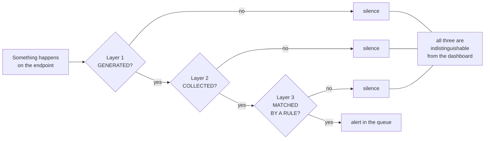

# Detection Methodology

A reusable method for answering one question about any data source: **if the thing I care
about happens, will I see it?**

Everything here was derived from measurements taken on the lab described in
[`01-lab-architecture.md`](01-lab-architecture.md). Where a claim came from a measurement, the
measurement is given. Where something has not been tested, it says so.

---

## 1. The thesis

An alert reaching an analyst has already survived three independent steps:

1. **GENERATED** — the operating system, or a sensor on it, wrote a record of the event.
2. **COLLECTED** — that record was shipped to the SIEM.
3. **MATCHED** — a rule in the SIEM recognised it and turned it into an alert.

Each step can fail on its own, for unrelated reasons, and **all three failures look exactly the
same from the dashboard: nothing.** There is no error, no counter, no "expected but missing"
indicator. The dashboard shows an empty result set, which is also what a genuinely quiet
endpoint looks like.

That symmetry is the whole problem. It means **absence of an alert is never evidence of absence
of activity**, and it means coverage cannot be assessed by searching the alert index — the index
is bounded by the ruleset, not by what the endpoint produced.



As a funnel on this lab. The middle column is where it breaks down:

| Exercise | Generated | Reached the manager | Became alerts |
|---|---|---|---|
| 2026-08-08 | not counted | not counted at the manager; the agent's own send counter read 2,098 | 835 indexed for the endpoint |
| 2026-08-11 (B4) | 172 on the endpoint over the widened window (167 on the first, window-clipped pass) | **not counted** | 36 |

**Layer 2 was never measured in this lab.** The middle column cannot be filled from the alert
index, because the manager writes to the index only what matched a rule — so an event that
arrived and matched nothing is indistinguishable, from the SIEM side, from one that never
arrived. The agent's send counter is the closest thing to a figure, and it is agent-side: it
records what the agent believes it sent, not what the manager received. Everything in this
document that says "collected" is therefore *inferred* from the channel being declared in
`ossec.conf` and the agent reporting `connected`. §2 gives the measurement that would replace
the inference, and §9 marks the gaps whose layer that inference decides.

What *is* measured is the two ends. In the first exercise fewer than half of the events the
agent reported sending came out as indexed alerts. In the second, 167 events were counted on the
endpoint over a narrow window and 27 alerts came out of the index; recounted over the widened
window that removes the boundary artefact, 172 events against 36 alerts: **79% of what the
endpoint generated never became queryable.** Whether that 79% died at layer 2 or at layer 3 is exactly what this lab cannot yet
separate — and saying so is the point of the model, not an excuse for it.

---

## 2. The three layers

### Layer 1 — Generation

**Question:** does anything on the host write a record when this happens?

Generation fails for four reasons, in rough order of how often they bite:

- **The audit subcategory is off.** Windows writes 4688 only if Process Creation auditing is
  enabled. Nothing is missing; nothing was ever written.
- **The field is off even though the event is on.** 4688 exists by default without the command
  line. Enabling `ProcessCreationIncludeCmdLine_Enabled` is a separate switch, and without it
  `cmd.exe` looks identical whether it listed a directory or downloaded a payload.
- **The sensor is not running.** A telemetry script that appeared to complete but aborted at the
  step that installs Sysmon leaves a host that looks configured and is not. This happened here:
  wrapping the baseline script in `Tee-Object` under PowerShell 5.1 turned a native
  executable's stderr into a terminating error, steps 1–5 applied, and `Sysmon64.exe -i` never
  ran (see `01-lab-architecture.md` §5).
- **The platform genuinely does not record it, or the configuration does not.** These look
  identical from the channel and they are not the same finding. A TCP SYN to a closed port is
  the example worked through in §3.2: nothing on this endpoint recorded one, but that is because
  the *Audit Filtering Platform Packet Drop* subcategory (5152/5153) is off, not because Windows
  has no record of it. Before writing "the platform does not record this", check whether a
  subcategory or a sensor setting would.

**How to test layer 1 independently:** cause the event deliberately, then read the channel on
the host with the SIEM entirely out of the picture:

```powershell
Get-WinEvent -FilterHashtable @{LogName='Security'; Id=4697; StartTime=(Get-Date).AddMinutes(-10)}
```

If it is there, layer 1 passes and nothing else about the SIEM matters yet. If it is not, stop —
no rule can be written for an event that does not exist.

### Layer 2 — Collection

**Question:** does the record leave the host and arrive at the SIEM?

Failure modes seen or reasoned about here:

- **The channel is not declared to the agent.** A Windows agent forwards the channels named in
  its configuration and no others. A channel that exists on the host and is absent from
  `ossec.conf` produces perfect local logs and nothing in the SIEM.
- **The agent cannot read the channel.** Reading `Security` requires membership in
  `Event Log Readers` — and on Windows that membership only takes effect after the token is
  reissued. Adding the account made `Get-LocalGroupMember` show it immediately while processes
  kept failing with *"Attempted to perform an unauthorized operation"* until the VM was
  **rebooted**. Group-membership caching, not UAC filtering.
- **The event is overwritten before it ships.** Channels are circular. The Security channel
  defaults to 20 MB; with process auditing and Sysmon both on, that is not much history. Raised
  to 256 MB here.
- **There is no sensor on that plane at all.** A host agent reads host logs. It is not a network
  sensor and never becomes one.

**How to test layer 2 independently:** confirm the agent's status is `connected`, confirm the
channel is listed in the agent configuration, and compare an event count on the host against the
count that arrived. The host-side count is the ground truth; the SIEM side is the claim.

**This lab has done the first two and not the third, and that is a real hole in this document.**
The count that arrived was never produced, for any channel, in any exercise. It cannot be
produced from `wazuh-alerts-*`, because the manager indexes only what a rule matched — an event
that arrived and matched nothing leaves no row to count. The measurement that would settle it is
specific and cheap: set `<logall_json>yes</logall_json>` on the manager, re-run one exercise, and
count the same events in `wazuh-archives-*`, which holds everything decoded regardless of whether
a rule fired. That has not been done here. Until it is, every "layer 3" verdict below carries an
unstated assumption — that the event actually arrived — and a layer-2 failure would produce
identical evidence. Where that matters to a specific finding, it is said in place.

### Layer 3 — Matching

**Question:** is there a rule looking for this?

This is the layer that produces the most confident wrong answers, because layers 1 and 2 both
passed. The record exists, it is correct, it arrived — and the SIEM discards it, because the
manager writes to the index **only what matched a rule**. From the dashboard, the event never
happened.

Failure modes:

- **No rule exists for that event ID.** Section 3.1.
- **A rule exists but is a catch-all.** Full coverage, zero selectivity. `whoami.exe` and
  `sppsvc.exe` produced byte-for-byte equivalent level-3 alerts here.
- **A rule exists but matches on the wrong thing.** It fires on a string that a different locale,
  a different tool version or a renamed binary does not produce.
- **The rule needs a field the source does not carry.** T1036.003 (Rename System Utility) cannot
  be detected from Security 4688, because 4688 has no `OriginalFileName`. No rule can read a
  field that is not in the event.

**How to test layer 3 independently:** having confirmed the event exists on the host and arrived
at the SIEM, query the alert index for it by field. If the event is in the SIEM but not in the
alert index, layer 3 is the gap and it is invisible by construction.

---

## 3. Worked examples

All four are from this lab and all four are the same shape — silence — with different causes.

### 3.1 Event ID 4697: generated, collected, never matched

`Get-WinEvent -FilterHashtable @{LogName='Security'; Id=4697}` returned
*"4697 A service was installed in the system"* at 2026-08-08 21:44:56 local, inside the exercise
window. **Layer 1 passes.**

The `Security` channel is declared in the agent's `ossec.conf` and the agent status was
`connected`. **Layer 2 is inferred to pass, and that is the weak link in this example.** No count
of Security events arriving at the manager was taken, and none can be taken from the alert index;
`wazuh-archives-*` with `<logall_json>` would give it and is not enabled here (§2). So what is
established is that collection is *expected*, not that it happened.

A query of `wazuh-alerts-*` returned **0 documents** with Event ID 4697. **Layer 3 fails — or
layer 2 does, and this evidence cannot tell them apart.** The reason for calling it layer 3 is
circumstantial rather than direct: other Security-channel events from the same window and the
same channel did reach the index (the 4688s, the 4720/4732/4726 sequence), so the channel as a
whole was plainly flowing. That is an argument, not a measurement, and it is worth less than the
one command that would replace it.

What makes this case instructive is that the same real-world fact — a service was installed —
*did* alert, through Event ID **7045** from the `System` channel. So the dashboard was not
silent about the event; it was silent about one of the two records of it. An analyst who
assumed Security-channel coverage of service installation, on the strength of seeing service
alerts in the queue, would have been wrong and would have had no way to notice.

There is nothing to search for here. No error, no missing-alert indicator, no dropped-event
counter. **The only way to find a layer-3 gap is to deliberately cause the event and check
whether it appears.**

Proposed rule (not yet written): match `Security` 4697 and alert when `ServiceFileName` points
outside `C:\Windows\System32`, or when `ServiceName` closely resembles but does not exactly
equal a known system service name (`svhost`, `lsass_`, `WinDefender`). Baseline exclusions for
known installers and monitoring agents. Mapped to T1543.003 and T1036.004.

### 3.2 The port scan: barely generated at all

`nmap -sS -p- -T4 10.10.10.20` ran for 88 seconds (00:47:17Z–00:48:45Z), found 8 open ports
(135, 139, 445, 3389, 5040, 5357, 7680, 49668) and 65,527 filtered. During those 88 seconds
Wazuh raised 6 alerts and **all 6 were unrelated background 4688 process-creation events**. Zero
alerts attributable to the scan.

A later, smaller scan was measured the same way: an `nmap -sn` sweep of the subnet followed by
`-sS -sV` against 7 ports left exactly **two** host-side records — two Sysmon Event ID 3 events
for inbound connections to `:3389` from `10.10.10.5` with `Initiated=false` — and **zero**
Security 5156 events, because the Filtering Platform Connection subcategory is not audited
(deliberately; it is very high volume).

This is a **layer 1 failure that no rule can repair**, and it is worth being precise about whose
failure it is. A Wazuh agent reads Windows event logs, and with the subcategories enabled on this
endpoint nothing was written for a SYN to a closed port. But Windows *can* write one: *Audit
Filtering Platform Packet Drop* emits 5152/5153 when the firewall drops a packet, which is
exactly the state of the 65,527 filtered ports. That subcategory is off here — it was not
considered when the audit policy was set — so this lab's silence is a configuration result, not a
platform limit. It has never been switched on and the scan has never been re-run against it, so
no count of 5152 events exists in this repository.

Note also which subcategory is the right one. *Filtering Platform Connection* (5156/5157) records
a connection **permitted**; on this scan it would have covered only the 8 open ports and told
nothing about the 65,527 others. Recommending it as the fix — which an earlier version of this
document did — would have produced almost no evidence of the very scan it was offered to detect.

The gap remains architectural in practice: either enable Packet Drop auditing and accept the
volume of a per-packet audit on an internet-facing-ish host, or put a network sensor — Suricata,
Zeek — on the segment. The second is the answer for this lab, because it also sees traffic that
never reaches this host, and until it exists "we detect reconnaissance" is a claim this lab
cannot make.

The distinction matters when reporting coverage. A layer-3 gap is a backlog item for a detection
engineer. A layer-1 gap of this kind is a purchase order or an architecture change, and calling
it a rule gap sends the work to the wrong team.

### 3.3 Sysmon 3 and 22: ingested, and nobody is looking

Layer 1 passes cleanly and is measured: Sysmon is running and the events are in the channel on
the host. Layer 2 is inferred, on the same terms as §3.1 — the
`Microsoft-Windows-Sysmon/Operational` channel is declared to the agent and the agent is
`connected`, but no count of arriving Sysmon events was taken. Sysmon Event ID 1 from the same
channel and the same window *did* reach the index, which is the circumstantial argument that the
channel was flowing.

| Source | Generated | Alerted |
|---|---|---|
| Sysmon 3 (network connection), B4 | 1 | 0 |
| Sysmon 3 (inbound to `:3389` from `10.10.10.5`), 2026-09-07 | 2 | 0 |
| Sysmon 22 (DNS query), B4 | 1 | 0 |
| PowerShell 4103 / 4104 / other, B4 | 110 | 0 |
| Security 4648 (explicit-credential logon), B4 | 1 | 0 |
| Security 4798 + 4799 (local group enumeration), B4 | 2 | 0 |
| Security 4689 (process terminated), B4 | 12 | 0 |

Three of these matter more than the rest:

- **Sysmon 22** is the DNS record of the host. Zero coverage means command-and-control
  resolution, domain-generation-algorithm behaviour and lookups to known-bad domains all pass
  silently, on a channel that is already being paid for in disk and bandwidth.
- **Security 4798/4799** is literally what SharpHound produces when it enumerates local group
  membership. Two events, zero alerts.
- **110 PowerShell events, zero alerts.** Script Block Logging was turned on specifically because
  it defeats obfuscation, and nothing in the default ruleset reads it.

These are the cheapest gaps to close in the whole lab: the data is already there. Contrast with
3.2, where closing the gap costs a new sensor.

Proposed rules, all still unwritten:
- Sysmon 3 where `Image` is an interpreter (`powershell.exe`, `cmd.exe`, `wscript.exe`,
  `mshta.exe`) and `DestinationIp` is outside the local subnet — reading the event's `UtcTime`,
  not the channel `TimeCreated` (§5). Secondary rule for repeated inbound `Initiated=false`
  connections from one source in a short window.
- Sysmon 22 where `QueryName` matches threat intel or a newly-registered-domain list, or where
  `QueryStatus` shows repeated NXDOMAIN from the same `ProcessGuid`. Correlate to the process by
  `ProcessGuid`, never by PID.
- 4648 at level ≥ 5 where `SubjectUserName` differs from `TargetUserName` and the calling process
  is not a known administrative tool — the `runas` / lateral-movement signature.
- Several 4798/4799 under the same `SubjectLogonId` inside a short window.

### 3.4 Discovery: matched, and the match is worthless

`whoami.exe` — the first thing most intruders run — generated a 4688 that was matched by rule
67027 at **level 3**, byte for byte the same treatment as `sppsvc.exe`. No Sysmon rule fired on
it either.

Technically layer 3 passed. Operationally it did not: an alert indistinguishable from background
noise is not a detection. In the same exercise Security 4688 alerted **16 of 16** through that
catch-all, and Sysmon Event ID 1 alerted **1 of 11** — and the one that fired (rule 92004,
level 4, *"Powershell process spawned Windows command shell instance"*) fired on the **pattern**
`powershell → cmd`, not on process creation.

That contrast is the useful part. The catch-all gives coverage and noise from the same rule;
the Sysmon rule gives signal, but only exactly where someone thought to look.

The conclusion for discovery activity (T1033, T1087, T1016) is that it **is not detectable one
command at a time**. A single `whoami` is genuinely indistinguishable from legitimate activity.
It has to be detected as a sequence: three or more of
`{whoami, net user, net localgroup, nltest, systeminfo, ipconfig /all, arp -a, quser}` created
under the same `ParentProcessGuid` or `SubjectLogonId` within 60 seconds.

**So there is a fourth outcome worth naming alongside the three layers: matched but not
actionable.** It looks like coverage on a report and behaves like a gap in a queue.

---

## 4. Severity is not priority

Rule severity answers *"how bad would this be if it were real?"* It says nothing about
*"how likely is it that this is real?"* Priority needs both, and a queue sorted by severity
alone gives you only the first.

### The measurement

The first end-to-end verification on 2026-08-08 drove activity across an 8-second window,
00:44:48Z–00:44:56Z. The alerts were counted over a deliberately widened query range,
00:44:40Z–00:45:10Z, for the boundary reason set out in §6.1. Inside that range Wazuh raised
**82 alerts**:

| Level | Count |
|---|---|
| 3 | 53 |
| 4 | 7 |
| 5 | 13 |
| 8 | 5 |
| 12 | 3 |
| **15** | **1** |

The single level 15 was rule 92213, *"Executable file dropped in folder commonly used by
malware"* (T1105), firing on:

```
C:\Users\<LAB_USER>\AppData\Local\Temp\__PSScriptPolicyTest_<random>.ps1
```

written by a signed `C:\Windows\System32\WindowsPowerShell\v1.0\powershell.exe`. That is
PowerShell creating a file to test its own execution policy. It is not an intrusion; it is
PowerShell starting up.

It reproduced: once on 2026-08-08, **5 times** on 2026-08-11, **12 times** on 2026-09-07.

Meanwhile, the simulated intrusion in that same window — a local user created, added to
Administrators and deleted **inside 8 seconds** (4720 → 4732 → 4726) — surfaced at **levels 8
and 12**. Below the noise.

The same inversion appeared again in the 2026-09-07 attack exercise:

| Rule | Level | Count | What it was |
|---|---|---|---|
| 92213 | 15 | 12 | The PowerShell false positive |
| 60204 (Multiple Windows Logon Failures, T1110) | 10 | 2 | Real: 18 password attempts |
| 92652 (ANONYMOUS LOGON) | 6 | 1 | Real: the SMB null session — the only reliable trace of the entire reconnaissance phase |
| 92657 (T1021.001) | 6 | 3 | Real: RDP |
| 60122 | 5 | 20 | The individual failed logons |

**The highest-value alert of the reconnaissance phase was a level 6, while twelve level 15s in
the same exercise were noise.**

### What follows from it

1. **Rule level is an opinion held by whoever wrote the rule**, formed without knowledge of this
   environment. It is a prior, and priors need updating against local base rates.
2. **An untuned high-severity rule actively degrades detection.** A level 15 that fires 12 times
   on legitimate activity teaches analysts that level 15 means nothing — which is precisely the
   condition under which a real level 15 gets closed without reading.
3. **Tuning is not a cleanup task, it is a detection task.** Excluding
   `__PSScriptPolicyTest_*.ps1` written by signed system PowerShell from rule 92213 restores the
   information content of the top of the queue. Until that is done, level 15 carries no
   information in this lab and should be stated that way rather than quietly ignored.
4. **Triage order should be driven by what the event means in context**, not by the number
   attached to it — an anonymous SMB logon from a host that has never authenticated before is
   worth more than any severity field.

---

## 5. Time

Three clocks describe the same event and two of them are wrong. Every one of these offsets was
measured on the same `eventRecordID`s, not inferred.

| Clock | What it actually measures | Measured error |
|---|---|---|
| `data.win.system.systemTime` (endpoint `TimeCreated`) | When Windows recorded the event | Reference |
| Wazuh `@timestamp` | When the **manager processed** it — and the dashboard's **default time axis** | −1.754 s / −1.821 s / −1.757 s on three consecutive records |
| Sysmon channel `TimeCreated` for EID 3 and 22 | When the event was **written to the channel**, not when it happened | DNS (22): 3.2 s late (17:22:40.464 vs `UtcTime` 17:22:37.222). Network (3): 4.0 s late (17:22:41.163 vs `UtcTime` 17:22:37.162) |

### Why the manager lag matters

The dashboard's default axis is `@timestamp`. Filtering for *"what happened at 17:22:36"*
therefore returns events Windows recorded at roughly 17:22:38. On a single source that is an
annoyance. Across multiple sources, where one is on the manager's clock and another on the
endpoint's, it destroys the order of facts — which is the only thing a timeline is for.

The lag was consistent at about 1.8 s, which means it is processing latency rather than drift.
NTP is configured on neither VM in this lab, so absolute skew is unmeasured and could be worse.
This becomes materially more serious once a domain controller exists, because Kerberos rejects
skew above five minutes.

### Why the Sysmon lag matters

Sorting by `TimeCreated` placed the DNS query **after** `whoami.exe` (17:22:38.7). It happened
before it. A timeline built on the channel timestamp reversed cause and effect using entirely
correct data.

### The rules

- **Pin every query and every timeline to `data.win.system.systemTime`.** Never to
  `@timestamp`.
- **For Sysmon events 3 and 22, read the event's own `UtcTime` field.** Never the channel's
  `TimeCreated`.
- **Establish the offset before trusting any cross-source ordering.** Pick one event that exists
  in two sources and measure the delta directly, as above.
- **Configure NTP.** Not a rule, a fix. Open in this lab.

The general principle: **every timestamp is a record of when some component noticed, not when
the event occurred.** Before building a timeline from a new source, find out which component
stamped the field you are sorting on.

---

## 6. Method errors to avoid

Four traps hit while producing the measurements above. Each one produced a confident, wrong
conclusion before it was caught.

### 6.1 Widen the window before declaring a gap

The initial B4 count showed 4 × 4624 generated / 2 alerted and 3 × 4672 / 1 alerted, which
looked like a filtering problem. Widening the range to 17:22:20–17:23:00 showed **8 × 4624 and
4 × 4672, every one of them alerting**. Each of the **4** automation calls produces a *pair* of
4624 events plus one 4672, and the pairs were being cut in half by the window boundary — which
is why the corrected counts are 8 and 4, not 16 and 8.

There was no gap. A false gap in a coverage report is as damaging as a false positive in a
queue, and harder to disprove later. Only the gaps that survived a widened window — 4648,
4798/4799, Sysmon 3, Sysmon 22 — were reported as real.

**Rule: before declaring a coverage gap, widen the window and re-count.**

### 6.2 Searching a SIEM is not `grep`

A `query_string` search for the unique marker `B4MARCA202608111422` returned **0 results** while
that exact string was sitting in `data.win.eventdata.commandLine` of indexed documents. The
query that worked targeted the field directly — for example a `terms` filter on
`data.win.system.eventRecordID`.

Field names and index analysis decide what is findable. An analyst who assumes free-text search
works concludes that evidence does not exist when it is in front of them — a fourth flavour of
silence, and one produced entirely by the analyst.

**Rule: confirm a field is searchable the way you are searching it before treating an empty
result as a fact.**

### 6.3 Same field name, different meaning

For the same process, Security 4688 reported `NewProcessId 0x1250` for the **created** process
and `ProcessId 0xdb4` for the **parent**, both hexadecimal. Sysmon 1 reported `ProcessId 4688`
for the **created** process and `ParentProcessId 3508`, both decimal.

Correlating the two sources on a field called `ProcessId`, without checking its semantics,
**inverts the process tree** — silently, producing a wrong report out of correct data. The same
two events also disagree on number base, so a value can look plausible while being a different
process entirely.

**Rule: for every field you join on, verify what it refers to and in what encoding, on a case
where you already know the answer.**

### 6.4 Check the tool's defaults before concluding the data is wrong

Two instances, one in the lab and one outside it. In the lab, the Sysmon channel already ships
with the ACE `(A;;0x1;;;S-1-5-32-573)` granting `Event Log Readers` access — a permissions
change attempted there would have been solving a problem that did not exist. Outside it, a
213-card study deck appeared to contain only one topic because the tool's default limit is 20
new items per day, and the reasonable-looking conclusion ("content is missing") was wrong.

Both have the same shape as the 4697 gap in reverse: the data was present and the presentation
layer made it invisible. **Rule: when a tool shows you less than you expect, check its defaults
before concluding the data is absent.**

---

## 7. Related idea: field-level coverage

The three layers describe whether an *event* arrives. There is a layer below them: whether the
*field you need* is in it.

Measured on the same process, Security 4688 lacks seven things Sysmon Event ID 1 carries —
`ParentCommandLine`, hashes, `OriginalFileName`, file metadata, `CurrentDirectory`, a
non-recycling process identifier, and a human-readable integrity level. (Sysmon 1, in turn,
lacks `TokenElevationType`, which 4688 has.) The full table is in
[`01-lab-architecture.md`](01-lab-architecture.md) §4.4.

Two detections die on that difference:

- **T1036.003, Rename System Utility.** `OriginalFileName` survives a rename; `Image` and
  `NewProcessName` do not. Security 4688 has no equivalent field, so the technique is
  undetectable from the Windows Security log alone regardless of how good the rule is.
- **Process-chain reconstruction.** Without `ParentCommandLine`, the analyst knows the parent was
  `cmd.exe` but not what it was doing, and must join on PIDs — which recycle. Sysmon's
  `ProcessGuid` does not, and it is what ties a process to its network (Sysmon 3) and DNS
  (Sysmon 22) events; all three carried the same GUID segment in the measured exercise.

So "is this technique covered?" decomposes into four questions, not three: is the event
generated, is it collected, does a rule match it, and **does the event contain the field the
detection depends on**.

### The same distinction applies to the events themselves

Two examples where a single Event ID carries two entirely different stories, separable only by
reading a field:

**4625 and `logonType`.** Ten failed logons in the 2026-08-08 exercise split cleanly into two
groups of five. Group A: `logonType 2`, `logonProcessName seclogo`, `AuthenticationPackage
Negotiate`, `ipAddress ::1`, workstation `WIN11-VICTIMA` — local `runas` attempts. Group B:
`logonType 3`, `logonProcessName NtLmSsp`, `NTLM`, `ipAddress 10.10.10.5`, workstation `KALI` —
`smbclient` from the attacker. All ten carried the same `subStatus` and the same description
text. A type 3 from an address that should never authenticate is an indicator; a type 2 is
usually a user mistyping. If you are not reading `logonType`, you are counting alerts, not
triaging them.

**4625 and `SubStatus`.** In the 2026-09-07 exercise, 18 attempts from `10.10.10.5`: 15 with
`SubStatus 0xC0000064` against non-existent accounts (18:30:10–18:30:43), then 3 with
`0xC000006A` against a real account (18:31:13–18:31:16). `0xC0000064` means *that account does
not exist* — enumeration, still shooting blind. `0xC000006A` means *that account exists, wrong
password* — the attacker now knows where to aim. **The transition between the two values is the
moment enumeration becomes a targeted attack**, and the correlation rule that fired
(60204, level 10) does not read the field at all, so it cannot tell the two apart.

The local lockout policy is 10 attempts / 10 minutes, so **the 15
attempts against non-existent accounts were free**. Lockout policy is blind to the enumeration
phase entirely.

### And a field that says the environment is defending itself

`Get-SmbServerConfiguration` on the endpoint returned `EnableAuthRateLimiter = True` and
`InvalidAuthenticationDelayTimeInMs = 2000`, a Windows 11 24H2+ default. Attacker-side, this
made `netexec` report *"The NETBIOS connection with the remote host timed out"* rather than a
wrong-password message — a mitigation that looks like a network problem. Defender-side, the 15
failures appeared **spaced about 2 seconds apart**.

That spacing is a fingerprint of **the mitigation**, not of the attacker's tooling. An analyst
who reads it as attacker behaviour builds a wrong profile of the adversary. And because the
delay only slows the attack, a slow campaign — one attempt per hour — evades it completely,
which is why 4625 events must be grouped by source IP over long windows (24 h), not only short
ones.

The same logic applies to RDP. With NLA enabled, **four failed RDP logins produced 4625 at logon
type 3, not type 10.** The only type 10 in the whole exercise appeared at 18:35:09, when a full
graphical session actually established (`Negotiate`, `LogonProcessName User32`, accompanied by
TerminalServices-LocalSessionManager 41 → 42 → 21 → 22 — session logon followed by shell start;
the 24 that followed at 18:36:49 is the disconnection, not part of the establishment). A
detection built on
*"RDP brute force = 4625 type 10"* misses every NLA-protected target — which is the default
configuration. The proposed fix is to correlate 4625 type 3 with
TerminalServices-RemoteConnectionManager activity in the same window, because the logon type
alone is not sufficient — but the corroborator is weaker than it looks and this lab has not
closed it. EID 1149 is *"User authentication succeeded"*, and the only 1149s measured here came
from the two successful authentications at 18:33:30–31, not from the four failures at
18:33:28–29. Whether a failed NLA attempt writes 261, or anything at all on that channel, has
not been confirmed in this lab. Until it is, "4625 type 3 alongside concurrent RDP listener
activity" is the most a rule here can honestly claim to detect.

---

## 8. Checklist for any new data source

Run this before claiming a source is covered. It is written to be executed in order; each step
gates the next, and a failure identifies which team owns the fix.

### Before you start

- [ ] **Name the specific behaviour** you want to detect, not the source. "Service installed
      from a path outside System32", not "service logs".
- [ ] **Write down what you expect to see, before you look.** A prediction that turns out wrong
      is a precisely located knowledge gap. A prediction written after the fact is not a test.
      In the B4 exercise, four hypotheses were stated up front and all four were falsified; that
      is where the useful findings came from.
- [ ] **Have a rollback point.** A clean snapshot, so destructive tests are possible.

### Layer 1 — Generation

- [ ] Trigger the behaviour deliberately, and record the exact time you did it.
- [ ] Read the raw channel on the host with the SIEM out of the picture
      (`Get-WinEvent -FilterHashtable`).
- [ ] If the event is absent: is the audit subcategory enabled? Is the sensor actually running
      (`Get-Service`, not "the install script said OK")? Is the required field switched on
      separately from the event?
- [ ] If the platform genuinely does not record it, **stop and record it as an architecture gap.**
      No rule fixes it.
- [ ] Confirm the event contains the **fields** your detection needs, not just the event ID.

### Layer 2 — Collection

- [ ] Is the agent `connected`?
- [ ] Is this channel declared in the agent configuration?
- [ ] Can the agent's identity actually read the channel? (On Windows, group membership requires
      a **reboot** to enter the token.)
- [ ] Count on the host and count in the SIEM. They should agree. The host count is the truth.
      **Count against the archive, not the alert index** — on Wazuh that means
      `<logall_json>yes</logall_json>` and `wazuh-archives-*`, because the alert index holds only
      what a rule matched and cannot tell "never arrived" from "arrived and matched nothing".
      This lab has not done it; §2 says what that costs the findings below.
- [ ] Is the channel large enough that the event survives until it ships? (Security defaults to
      20 MB; it is a circular buffer and overwriting is silent.)

### Layer 3 — Matching

- [ ] Query the alert index for the event **by field**, not by free text (§6.2).
- [ ] Widen the time window and re-count before declaring a gap (§6.1).
- [ ] If it alerts: what level, and what rule? Is the rule specific to the behaviour or a
      catch-all that fires on everything of that type?
- [ ] If it alerts at high severity: how often does it fire on **normal** activity? Measure this
      over a quiet period, not during your test.
- [ ] If it does not alert: this is a rule gap. Record the event, the channel, and a proposed
      rule with the fields it would read.

### Actionability — the fourth outcome

- [ ] Would this alert be distinguishable from background noise in a real queue?
- [ ] If not, does the behaviour need **sequence** detection rather than single-event detection?
- [ ] What would an analyst do on receiving it? If there is no next step, the alert is not
      finished.

### Time

- [ ] Which field is the dashboard sorting on by default, and what does that field actually
      measure?
- [ ] Does this source have its own internal timestamp that differs from the channel write time?
      (Sysmon 3 and 22 do — by 3–4 seconds.)
- [ ] Measure the offset against a known source on one event that exists in both.
- [ ] Pin queries to the endpoint's own clock.

### Recording it

- [ ] Write down what was tested, what was measured, and **what was not tested**.
- [ ] Classify each gap by layer — generation / collection / detection — because the layer
      decides who owns the fix. A detection gap goes to a detection engineer; a generation gap of
      the port-scan kind goes to architecture.
- [ ] State the remaining gaps explicitly. A coverage claim without its limits is not a coverage
      claim.

---

## 9. Applied output: the current gap register

The method above, applied to this lab, produces the following. It is the deliverable — a
coverage assessment is a list of specific, layer-classified, testable gaps, not a percentage.

| # | Gap | Layer | How it was established |
|---|---|---|---|
| 1 | Security 4697 (service installed) matched by no rule | detection (collection inferred, not measured) | Present in the channel, channel declared to the agent, 0 documents in `wazuh-alerts-*` |
| 2 | Sysmon 3 (network connection) has no coverage | detection | 1 generated / 0 alerted in B4; 2 generated / 0 alerted on 2026-09-07 |
| 3 | Sysmon 22 (DNS query) has no coverage | detection | 1 generated / 0 alerted |
| 4 | Security 4648 (explicit-credential logon) has no coverage | detection | 1 / 0, confirmed against a widened window |
| 5 | Security 4798/4799 (local group enumeration) has no coverage | detection | 2 / 0, confirmed against a widened window |
| 6 | PowerShell 4103/4104 have no coverage | detection | 110 generated / 0 alerted |
| 7 | Discovery commands are swept up by the catch-all 4688 rule at level 3 | detection | `whoami.exe` produced the same alert as `sppsvc.exe` |
| 8 | Port scans leave no host-side record under this audit policy | **generation** | 65,535-port scan, 88 s, 0 attributable alerts; 7-port scan left 2 Sysmon 3 events and 0 Security 5156. Nothing is written on the host, so there is nothing to collect — the failure is at layer 1. The subcategory that would write it, Filtering Platform Packet Drop (5152/5153), is off and has never been tested here |
| 9 | Password spraying is indistinguishable from ordinary failed logons | detection | Rule 60204 accumulates 60122 events without reading `SubStatus` |
| 10 | Rule 92213 fires at level 15 on benign PowerShell | detection | Reproduced 1× / 5× / 12× on three separate dates |
| 11 | RDP failure detection lacks listener-side corroboration | detection | 4 failed RDP logins appeared as 4625 type 3, indistinguishable from SMB by type |
| 12 | Security 1102 (audit log cleared) has never been generated | **untested** | 1102 has never been produced in this lab and no query has ever been run against it, so nothing is known about any of the three layers for it |
| 13 | No time synchronisation between endpoint and SIEM | **not a pipeline layer** | −1.8 s manager offset measured across three consecutive records, plus a 3–4 s Sysmon channel-write lag. Events are generated, collected and matched normally; what is defective is the timestamp on the evidence, which is a property of the record rather than of a stage |

Gap 12 deserves its label. It is not a detection gap and it is not a collection gap — **it is
untested**, which under this method is a distinct state and the correct one to record. The
`base-limpia` snapshot exists precisely so it can be triggered deliberately and the alert path
confirmed. Gap 13 is the other one that does not fit: a clock offset is a defect in the evidence,
not a stage of the pipeline, and forcing it into one of the three layers would have made the
column meaningless. Where the layer column says "inferred", it means what §2 says it means — the
channel is declared and the agent is connected, and nothing was counted at the manager.

---

## 10. Why this method, and not a coverage percentage

An ATT&CK coverage heat map is easy to produce and easy to get wrong, because colouring a
technique green requires only that *something* alerted once. Every finding in this document is a
counter-example to that:

- 4697 would look covered, because service installation alerts — through a different event.
- T1033 would look covered, because `whoami` produces an alert — one indistinguishable from a
  system process.
- T1105 would look covered, because rule 92213 fires at level 15 — 18 times, all false.
- T1046 would look uncovered and would be reported as a rule backlog item, when it is actually
  a missing sensor.

The method replaces the percentage with four questions per behaviour — generated, collected,
matched, actionable — plus a note on which clock stamped the evidence. It produces a longer and
less flattering answer, and it is the only one that survives being checked.

One last measurement in support of it. The technique with the **most** ATT&CK mitigations in the
five studied here, T1059 (Command and Scripting Interpreter), has eleven — and that is not a
sign of a well-defended technique. It means the attack surface is large enough to need eleven
angles and still leaves a gap. At the other end, T1036.004 (Masquerade Task or Service) has
**zero**: ATT&CK states outright that it cannot easily be mitigated with preventive controls,
because it abuses legitimate system features. Zero mitigations means *this is detected, not
prevented* — the whole problem lands on the SOC. And M1047, "Audit", is not a control at all; it
is an instruction to go and look, which is work assigned to an analyst.

That is the space this method operates in: between the control that exists and the control that
is actually applied, with a dashboard that shows silence either way.
