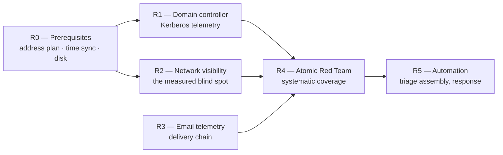

# Roadmap — engineering backlog

This is a backlog, not a list of aspirations. It contains no dates and no schedule, because
nothing here is blocked by time; every item is blocked by a capability that has to exist
first. The order below is the dependency order.

Each item states the same four things:

- **Blind spot** — what the lab cannot see today, with the measurement that established it.
- **What it unlocks** — the detections that become possible, not the products that get installed.
- **Acceptance criteria** — checks that pass or fail. No item is "done" because it was configured.
- **Cost and honest risk** — what it consumes on a single host, and what could make it not worth doing.

The lab currently has host visibility on one Windows endpoint, a SIEM that indexes what its
ruleset recognises, and an attacker VM. Everything below extends one of those three.

---

## Where the lab stands

Baseline measurements that the items below are written against. All were taken on this lab;
the exercises that produced them are in
[`investigations/002-process-telemetry-correlation.md`](../investigations/002-process-telemetry-correlation.md)
and [`investigations/003-smb-rdp-attack-chain.md`](../investigations/003-smb-rdp-attack-chain.md).

| Capability | Current state | Measurement |
|---|---|---|
| Endpoint process telemetry | Works, with a known noise floor | 172 events generated produced 36 alerts (2026-08-11), recounted over the widened window; the first, window-clipped pass reported 167 and 27 — see the window-edge note in `investigations/002`; Security 4688 alerted 16 of 16 through a catch-all rule at level 3, Sysmon Event ID 1 alerted 1 of 11 |
| Authentication telemetry | Works, including the field that matters | 18 password attempts, all carrying Status `0xC000006D`, separated by `SubStatus` into 15 × `0xC0000064` (accounts that do not exist) and 3 × `0xC000006A` (real account, wrong password), 2026-09-07 |
| Network visibility | None | A 65,535-port TCP SYN scan lasting 88 seconds produced 0 attributable alerts (2026-08-08). A 7-port `-sS -sV` scan left 2 Sysmon Event ID 3 records and 0 Security 5156 records |
| Domain / Kerberos telemetry | None — no domain exists | `DC01` is planned at 4 GB RAM / 2 vCPU on 10.10.10.5 and has not been created |
| Email telemetry | None — no mail server exists | T1684.002 (Email Spoofing) was studied from ATT&CK on 2026-07-31 and recorded as not reproducible in this lab |
| Systematic technique coverage | Ad hoc | Portfolio counter as of 2026-09-07: ATT&CK techniques simulated and detected = 3 (target 10); own Sigma rules deployed = 0 — 21 rule documents across 12 files are drafted in `detections/sigma/`, none has been deployed to the lab manager, so none is validated in this repository's sense of the word |
| Time agreement between sources | Absent | Wazuh `@timestamp` measured 1.754 s / 1.821 s / 1.757 s behind the endpoint's `systemTime` on three consecutive event records; inside Sysmon, events 3 and 22 reach the channel 3.2 s and 4.0 s after their own `UtcTime` |

Two facts constrain everything below, and both are measured rather than assumed:

- **Detection is bounded by the ruleset, not by the telemetry.** Roughly 2,100 events reached the
  manager during the 2026-08-08 exercise and 835 alerts were indexed for that endpoint. Adding a
  source without adding detection logic increases the first number and not the second.
- **Severity is not priority in this lab.** Rule 92213 fired at level 15 on benign PowerShell
  behaviour 1 time on 2026-08-08, 5 times on 2026-08-11 and 12 times on 2026-09-07, always on
  `__PSScriptPolicyTest_*.ps1` written by signed system PowerShell. Any item that consumes alert
  severity as an input — automation above all — is unsafe until that is tuned.

---

## R0 — Prerequisites that block the rest

Three small pieces of work that are not capabilities in themselves. They are listed first
because each one silently breaks a later item.

### R0.1 Address plan collision

DHCP on the `SOCLAB` NAT network handed **10.10.10.5 to Kali**, which is the address reserved
in the lab plan for `DC01`. Creating the domain controller before fixing this produces an
address conflict, and — worse for the evidence — every historical measurement of the attacker's
source address (`10.10.10.5` appears throughout the 2026-09-07 exercise) would become ambiguous
between "the attacker" and "the domain controller".

### R0.2 Time agreement

The manager clock lags the endpoint by about 1.8 s, and Sysmon writes events 3 and 22 to the
channel 3-4 s after they occur. Both offsets are documented and both are survivable today by
querying `data.win.system.systemTime` (and `UtcTime` for Sysmon 3 and 22) instead of the
dashboard's default axis. They stop being survivable at R1: Kerberos rejects a skew above
5 minutes, so a domain that is not time-synchronised fails to authenticate rather than failing
to correlate.

### R0.3 Host capacity

| Resource | Measured | Note |
|---|---|---|
| RAM | 20 GB of 48 GB used by the three running VMs | `DC01` is planned at 4 GB; RAM is not the binding constraint |
| Disk | 259 GB free on 2026-07-29, 46 GB free (96 % used) on 2026-09-07 | Disk **is** the binding constraint |
| Reference install size | The Windows 11 endpoint install grew the disk 0 → 17.2 GB | The only measured reference point for what a new Windows VM costs |

Free space must be checked and recorded before any new VM is created, not after the installer
runs out of room.

### Acceptance criteria — R0

| # | Check | Passes when |
|---|---|---|
| R0-A | Address plan | 10.10.10.5 is reserved for `DC01` and Kali holds a different address; `inventario` reflects it; the change is noted in the writeup that first mentions a new attacker IP |
| R0-B | Time sync | Endpoint and SIEM both synchronise to the same source, and the delta between `data.win.system.systemTime` and Wazuh `@timestamp` is re-measured on three consecutive event records and recorded |
| R0-C | Query hygiene | Every saved query and every rule written from here on pins its time field explicitly (`systemTime`, or `UtcTime` for Sysmon 3 and 22) |
| R0-D | Capacity | Free disk space is recorded immediately before and after each new VM, so the cost of the next VM is a measurement and not a guess |

---

## R1 — Domain controller and Kerberos telemetry

**Blind spot.** Every authentication measured in this lab so far is local: NTLM over SMB, local
accounts, `runas`, RDP into a local account. The 2026-09-07 chain ended at
`T1078.003 — Valid Accounts: Local Accounts` because there is no other kind of account to abuse.
An entire authentication protocol, and the attack classes built on it, produce nothing here
because they have nothing to run against.

**What it unlocks.** A domain turns the endpoint from a standalone machine into a member of
something, and that "something" is where most real SOC work happens:

- Kerberos authentication telemetry on the DC (ticket requests, service ticket requests,
  pre-authentication failures) instead of NTLM-only evidence on the endpoint.
- Credential attacks that are domain-shaped by definition: ticket-based service account attacks,
  AS-REP style attacks against accounts without pre-authentication, directory replication abuse.
- Domain-wide account and group manipulation, which is the same activity as the 2026-08-08
  local sequence (4720 → 4732 → 4726 in 8 seconds, alerting at levels 8 and 12) but visible on
  a single central source instead of one host at a time.
- `T1484 — Domain or Tenant Policy Modification`, currently marked detected only through a local
  Administrators group change, gets its actual domain meaning.
- Logon type coverage that a member workstation cannot produce on its own: network logons
  arriving at the DC, and lateral movement between two domain-joined machines.

**Honest scoping note.** The event IDs a domain controller emits are documented by Microsoft, not
measured here. This item does not claim them; it commits to measuring them. Every claim about
Kerberos telemetry that ends up in this repository has to come out of the exercise below, in the
same three-layer form used everywhere else — generated / collected / detected — because the
lab has already produced one case where a Security event was generated and forwarded and still
never alerted (4697, measured 2026-08-08).

**Work.**

1. Create `DC01` (4 GB / 2 vCPU, 10.10.10.5) after R0.1 and R0.3.
2. Promote it, join `WIN11-VICTIMA`, and record what the join itself generates on both sides.
3. Install the Wazuh agent on the DC and forward the same channel set already proven on the
   endpoint, plus the directory service channels.
4. Enable the audit subcategories the domain adds, using the same approach as the endpoint
   baseline script — apply, then verify by end state rather than by the script's exit status.
   This is the failure that already cost this lab a Sysmon install once, when a script wrapped in
   `Tee-Object` aborted at step 6 under PowerShell 5.1 and reported nothing.
5. Re-run the 2026-09-07 attack chain against a domain account and diff the resulting telemetry
   against the local-account run.

**Acceptance criteria — R1**

| # | Check | Passes when |
|---|---|---|
| R1-A | Domain exists and is joined | `WIN11-VICTIMA` authenticates a domain account, and the `base-limpia` snapshot story is re-established: a rollback of both VMs leaves the domain functional, verified the same way the current snapshots were (services running, addresses intact) |
| R1-B | DC telemetry reaches the SIEM | Wazuh agent on `DC01` reports `connected`, and a query returns events from the DC for a deliberately generated domain logon |
| R1-C | Three-layer verdict recorded | For each Kerberos-related event ID exercised, the writeup records generated (present in the log) / collected (present in the index) / detected (produced an alert, with rule ID and level) — the same generated / collected / detected table shape used everywhere else in this repository |
| R1-D | At least one domain-only attack is executed and triaged | A credential attack that has no local-account equivalent is run from Kali against the domain and investigated from the SIEM, with exact timestamps and the fields that separate it from ordinary authentication |
| R1-E | Coverage gaps are declared, not implied | Every DC event ID that generates and collects but does not alert is added to the gap inventory with a proposed rule, exactly as 4697, 4648 and 4798/4799 were |
| R1-F | Time discipline holds | Kerberos authentication succeeds, which is itself the proof that R0.2 was done, and timeline construction still uses the endpoint/DC clocks rather than `@timestamp` |

**Cost and risk.** 4 GB of the 28 GB of RAM currently unused, plus disk that has to be confirmed
against the 46 GB measured free. The real risk is scope: a domain multiplies the event volume,
and the funnel already measured (about 2,100 events → 835 alerts) will widen. R1 is not finished
when the domain works; it is finished when the gap inventory has grown.

---

## R2 — Network visibility

**Blind spot, measured twice.** This is the largest and best-evidenced hole in the lab.

| Exercise | Attacker action | Host-side residue |
|---|---|---|
| 2026-08-08 | `nmap -sS -p- -T4` — 65,535 ports in 88 seconds, 8 ports found open | **0** attributable alerts. The 6 alerts inside the window were unrelated background 4688 process creations |
| 2026-09-07 | `nmap -sn` sweep plus `-sS -sV` against 7 ports | **2** Sysmon Event ID 3 records (inbound to :3389 from 10.10.10.5, `Initiated=false`) and **0** Security 5156 records |

This is structural, not a misconfiguration — but the structure is this endpoint's audit policy as
much as the agent's design. A Wazuh agent reads Windows event logs, and with the subcategories
enabled here, nothing recorded the scan. The subcategory that would is **Audit Filtering Platform
Packet Drop** (5152/5153), which records a packet the Filtering Platform dropped — the 65,527
filtered ports. It is off, deliberately, for volume, and it has never been measured in this lab.
**Audit Filtering Platform Connection** (5156/5157) is a different thing: it records permitted and
blocked connections, so even enabled it would only have covered the eight ports that answered.
No additional Wazuh rule can close the gap with the telemetry that exists, which is the point: it
is an architecture gap, and the recommended answer is a sensor on the network segment rather than
more rules on the host.

**What it unlocks.**

- `T1046 — Network Service Discovery` becomes detectable at all. It is currently recorded as not
  detected, on the strength of the two measurements above.
- Traffic that never touches the monitored endpoint: scanning of the SIEM itself, host-to-host
  activity once `DC01` exists, and anything targeting a machine with no agent.
- Protocol-level evidence for the attacks already detected on the host, so a failed logon has a
  packet-level counterpart rather than only an event ID.
- The missing portfolio category. One of the four required writeup categories is covered
  (endpoint). Network, phishing and unscripted investigation are all open; R2 unlocks the first
  and R3 the second. The counter for solved packet-capture exercises is 0. The 2026-09-07 chain
  does not count towards the network category, because it contains host logs and no capture, and
  it does not count towards unscripted investigation either: the same person ran the attack and
  knew the answer before querying.

**Design decision this item must make and document.** There are two candidate approaches and they
are not equivalent:

1. **Host-side**: enable Windows Filtering Platform auditing — Packet Drop (5152/5153) for the
   dropped SYNs, Connection (5156/5157) for the ports that answer — and write a rule for many
   distinct destination ports from one source address inside a short window. Cheap to try, but it
   accepts a log volume that was deliberately avoided, and it still only sees traffic to that one
   host.
2. **Network sensor** (Suricata or Zeek) watching the `SOCLAB` segment. This sees traffic between
   any two VMs, at the price of a fourth VM and of a topology change: a VirtualBox NAT Network
   does not hand out a mirror port, so the sensor has to sit where the traffic actually passes.
   Determining that placement, and proving it with a capture, is part of the work.

The backlog's position is that option 2 is the correct one and option 1 is worth measuring first
precisely because it is cheap — the comparison itself is a result worth writing down.

**Acceptance criteria — R2**

| # | Check | Passes when |
|---|---|---|
| R2-A | The original scan stops being invisible | `nmap -sS -p- -T4 10.10.10.20` is re-run and produces at least one alert attributable to the scan, naming the source address. The baseline to beat is literally zero |
| R2-B | Coverage extends past the endpoint | A scan aimed at `WAZUH-SIEM` (a host with no Windows agent) is also detected |
| R2-C | Capture retained and analysable | A packet capture of one full attack chain is stored outside the repository and analysed in a writeup, with the protocol-level evidence lined up against the host events by timestamp |
| R2-D | Sensor placement is proven, not assumed | The writeup shows a capture containing traffic between two VMs neither of which is the sensor — the check that separates a real vantage point from a hopeful one |
| R2-E | Volume is quantified | The chosen option's cost is measured: events or alerts per hour added at idle, so the decision to keep it is made on a number |
| R2-F | The comparison is recorded | If option 1 is tested, its result (what 5152/5153 and 5156/5157 each do and do not show, and at what volume) is written down even if the conclusion is that it was the wrong tool |

**Cost and risk.** A fourth VM against 46 GB of free disk and 28 GB of unused RAM, plus retention
for captures, which is the resource this lab is closest to exhausting. Risk of over-collection is
real: the funnel measured on the host side (172 → 36, and about 2,100 → 835) gets worse with a
source that produces an event for every connection. R2-E exists to force that into the open.

---

## R3 — Email and phishing telemetry

**Blind spot.** The most common initial access path in the incidents a SOC L1 actually sees has
no representation in this lab. `T1684.002 — Social Engineering: Email Spoofing` was studied in
depth on 2026-07-31 and recorded as not reproducible here, because there is no mail server. Two
of its three ATT&CK mitigations (M1036 Account Use Policies, M1047 Audit covering SPF/DKIM/DMARC,
M1017 User Training) depend on parties the defender does not control, which makes the detection
side disproportionately important — and currently untestable.

**What it unlocks.**

- The delivery half of an intrusion. Everything measured in this lab so far starts with the
  attacker already able to reach a port. Phishing starts earlier than that.
- Header-level analysis as a triage skill: reading a received chain, evaluating SPF/DKIM/DMARC
  results, and separating a spoofed envelope sender from a display-name lookalike.
- `T1659 — Content Injection`, already assessed as reproducible in this lab without any exploit,
  and mapped in ATT&CK to a chain this lab can already see end to end: Sysmon 11 (an executable
  written to Temp, Downloads or a browser cache) → Sysmon 1 with the browser as `ParentImage` →
  Sysmon 3 outbound. That chain currently has zero detection coverage — both Sysmon 3 and
  Sysmon 22 alerted 0 times out of 1 generated event each in the 2026-08-11 exercise.
- Attachment execution as a parent-child pattern rather than a single process event. The one
  Sysmon Event ID 1 alert out of 11 in that exercise fired on the `powershell → cmd` **pattern**
  (rule 92004), not on process creation, which is the shape any attachment detection has to take.

**Work.** A minimal self-contained mail path inside `SOCLAB` — no external mail, nothing leaving
the lab — sufficient to deliver a message with controlled headers and a controlled attachment to
the endpoint, plus collection of whatever that mail component logs.

**Acceptance criteria — R3**

| # | Check | Passes when |
|---|---|---|
| R3-A | A message can be delivered on demand | A message with attacker-controlled headers reaches the endpoint, entirely inside the lab network |
| R3-B | Spoofing is observable | A spoofed sender is delivered and the authentication result (SPF/DKIM/DMARC outcome) is visible in the recorded evidence, so the difference between a passing and a failing message is a field and not an opinion |
| R3-C | The execution chain is complete | Opening the attachment produces a correlated chain from the mail client to the child process to any network connection, joined by Sysmon `ProcessGuid` rather than by PID — the field that does not recycle, and the one that already tied Sysmon 1, 3 and 22 together in the 2026-08-11 exercise |
| R3-D | At least one detection is written | A rule covering the attachment-execution pattern is committed to `detections/sigma/` and passes the repository's Sigma validation |
| R3-E | Triage procedure exists | A playbook for a reported phishing message is written from the lab evidence, in the same form as the existing playbooks |

**Cost and risk.** The lightest item in resource terms and the heaviest in "could turn into a
project of its own". The risk is building a mail infrastructure instead of building detection;
R3-A is deliberately worded as the minimum that makes R3-B and R3-C possible.

---

## R4 — Atomic Red Team for systematic technique coverage

**Blind spot.** Coverage is currently established one exercise at a time, by hand. The counter on
2026-09-07 read: ATT&CK techniques simulated and detected = 3, against a target of 10; alerts
triaged = 2, against a target of 50; own Sigma rules deployed = 0, with 21 rule documents across
12 files drafted and none deployed to the manager. Techniques studied from documentation
(five, read in depth on 2026-07-31) are not the same as techniques exercised, and the repository
is careful to keep those two claims apart. What is missing is a way to execute many techniques
reproducibly and record a verdict for each.

**Why it comes after R1, R2 and R3.** Running a technique library against a lab that cannot see
domains, cannot see the network and cannot see email produces a long list of "not detected" that
says more about the lab's architecture than about its detection logic. The value of a systematic
run comes from being able to act on each negative result.

**What it unlocks.**

- A repeatable, per-technique verdict in the three-layer form this repository already uses:
  generated / collected / detected.
- An ATT&CK Navigator layer that is regenerated from evidence instead of being maintained by
  hand. Every coloured cell traces to an execution and a query.
- A queue of detection work with a defensible priority order: each "generated and collected but
  not detected" result is exactly the class of gap that 4697 turned out to be — invisible from
  the dashboard, discoverable only by deliberately causing the event.
- Regression testing. Once a rule is written, re-running the same technique is how you find out
  it still fires.

**Prerequisite inside this item.** Rule 92213 must be tuned before a bulk run, and the tuning is
already specified by the measurement: exclude `TargetFilename` matching `__PSScriptPolicyTest_*.ps1`
where the image is the signed system PowerShell. Until that exclusion exists, level 15 carries no
information in this lab, and a run that produces hundreds of alerts cannot be read.

**Acceptance criteria — R4**

| # | Check | Passes when |
|---|---|---|
| R4-A | Execution is reproducible and reversible | Each technique run starts from the `base-limpia` snapshot and the endpoint is restored afterwards, verified as the existing restoration test was (Sysmon service running, Wazuh service running, static address intact) |
| R4-B | Every run produces a verdict | For each technique executed: the event IDs generated, whether they appear in the index, and whether an alert fired with rule ID and level. No blank cells |
| R4-C | Negatives become work items | Every "generated and collected, not detected" result is added to the gap inventory with a proposed rule. Every "not generated" result is recorded as a telemetry gap instead, which is a different problem with a different fix |
| R4-D | The Navigator layer is derived | `detections/attack-navigator-layer.json` is produced from the verdict table, passes the repository's JSON validation, and no technique is scored as detected without a recorded alert behind it |
| R4-E | Noise is under control first | The 92213 exclusion is in place and verified by re-running the PowerShell activity that triggered it 12 times on 2026-09-07 |
| R4-F | The counters move honestly | The portfolio counters are updated from the verdict table only — techniques simulated **and detected**, not techniques attempted |

**Cost and risk.** Cheap in hardware, expensive in discipline. The failure mode is a large green
Navigator layer built on techniques that were executed but never confirmed as detected, which
would undo the one thing this repository is for. R4-D and R4-F exist specifically to prevent that.

---

## R5 — Automation and response

**Blind spot.** Everything in this lab is done by hand. Queries are issued from the host with
`curl` against the dashboard's console proxy, because the indexer listens only on localhost inside
the SIEM VM and a NAT port-forward to it fails at the TLS layer. That works and it is scripted,
but the analysis on top of it is manual: assembling a timeline, splitting failed logons by
`SubStatus`, correlating an RDP failure with its listener-side records.

**Why it is last, and this is the important part of the item.** Automation multiplies whatever
decision quality already exists. This lab has measured its own decision quality and it is not yet
good enough to automate on:

- A level 15 rule fired 12 times in one exercise on benign activity. An automatic response keyed
  to severity would have acted 12 times, wrongly.
- The most valuable alert of the 2026-09-07 reconnaissance phase was a **level 6** (rule 92652,
  the anonymous SMB session) — below everything the noise would have prioritised.
- More than half the telemetry never becomes an alert at all, so any automation that reads only
  the alert index inherits that bound.

Automating before R4 would encode those defects into a machine that repeats them faster. That is
the argument for the ordering, and it is worth more in an interview than the automation itself.

**What it unlocks.**

- Triage assembly: given one alert, gather the surrounding evidence that a human currently
  gathers by hand — the `LogonId` thread (a 4624's `TargetLogonId` reappearing in every 4688,
  Sysmon 1 and the closing 4634, verified end to end in this lab), the `SubStatus` split, the
  source address history over a long window.
- Long-window correlation that short-window rules structurally cannot do. The SMB rate limiter
  measured on the endpoint (`EnableAuthRateLimiter = True`,
  `InvalidAuthenticationDelayTimeInMs = 2000`) spaces failures about 2 seconds apart, and an
  attacker who slows down further evades a short-window rule entirely — so failures have to be
  grouped by source address over 24 hours, which is work better done by a scheduled job than by a
  correlation rule.
- Active response, last of all, and only where a wrong action is cheap to undo.

**Acceptance criteria — R5**

| # | Check | Passes when |
|---|---|---|
| R5-A | Reproduces a human investigation exactly | Given the 2026-09-07 window, the triage script outputs the same facts the manual investigation reported: the 15/3 `SubStatus` split, the source address, the logon types, the successful authentication that followed. Field-for-field, or it fails |
| R5-B | Uses the right clock | Every timeline it builds uses `data.win.system.systemTime`, and `UtcTime` for Sysmon 3 and 22. A script that inherits the 1.8 s manager offset produces a plausible and wrong order of events |
| R5-C | Output is reviewable | It writes a markdown bundle a human reads and signs off on, not a verdict it acts on alone |
| R5-D | Long-window rule exists | A 24-hour grouping of failed logons by source address runs on a schedule and is tested against a deliberately slow guessing run |
| R5-E | Any automatic action is gated on a measured false-positive rate | No response action is enabled for a rule whose false-positive behaviour has not been measured in this lab. Rule 92213 is the standing example of why |
| R5-F | Failure is visible | If the automation stops running, that is itself detected. A silent scheduler is indistinguishable from a quiet network — the same reasoning as the 4697 gap, where nothing failed and nothing appeared |

**Cost and risk.** Low hardware cost, high credibility cost if done badly. An automated response
in a three-VM lab is a demonstration, not an operational control, and it will be presented that
way.

---

## Not on this backlog, and why

| Item | Why not |
|---|---|
| Migrating to a different SIEM | The SIEM is not the constraint; the ruleset and the missing sources are. A migration would reset the measurements and produce no new capability |
| Live malware detonation | Requires isolation guarantees this lab does not have — the VMs reach the internet through the NAT network by design |
| Cloud or SaaS telemetry | No account, no measurements, nothing honest to write. It would be a claim rather than a result |
| An EDR product alongside Wazuh | Adds a second opinion before the first one has been tuned. R4 has to finish first |
| More dashboards | The dashboard already displays more than the ruleset can justify. Visualising an incomplete index makes the gaps less visible, not more |

---

## Definition of done, for any item above

An item is closed when all of these hold:

1. Every acceptance criterion in its table passes, and the evidence for each is a command, a
   query or a screenshot that someone else could re-run.
2. A writeup exists, with the prediction written **before** the data was pulled. Predictions that
   turn out wrong are kept in the writeup: four hypotheses were falsified in the 2026-08-11
   exercise and two in the 2026-09-07 one, and that is the most useful part of both.
3. Every gap found is recorded in the gap inventory (`docs/03-detection-gap-analysis.md`) with its
   layer — generation, collection or detection — and a proposed rule.
4. Any rule written is committed under [`detections/sigma/`](../detections/sigma/) and passes the
   repository's own validation workflow.
5. The counters in the progress log are updated from measurements, never from effort.
